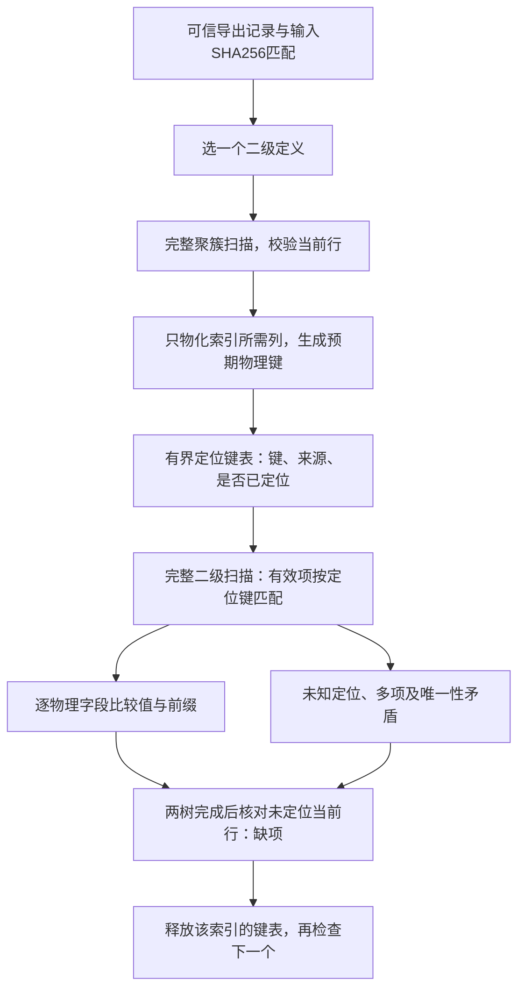

# 100. 聚簇与二级索引双向校验

## 学习目标与前置概念

判断合格稳定快照中所选二级索引与当前聚簇行是否对应，并区分确定矛盾、前提不足和执行中断。前置为[二级物理布局](71-secondary-record-layout.md)、[投影与回表](74-projection-and-lookup-validation.md)、[删除标记](57-delete-mark-layout.md)和[结构化诊断](98-structured-diagnostics.md)。当前版本、类型及前缀范围继续以[支持矩阵](83-release-support-matrix.md)为准。

## 入口与可信前提

`CheckIndexConsistency(ctx, reader, size, table, indexes, ConsistencyOptions)`接受可信Schema及至少一个显式SecondarySchema。Materialized变体单独报告未索引VIRTUAL定义，不求值；普通入口遇到VIRTUAL拒绝。只认证提供定义的普通BTREE索引，不推断清单完整，不增加自动SDI入口、分区接口或正式CLI参数。

只有`.ibd`本身不足以证明相关change buffer已合并，也不能从事务ID或删除标记推导提交状态。[官方FOR EXPORT说明](https://dev.mysql.com/doc/refman/8.0/en/flush.html)规定导出完成时会先合并change buffer并刷出脏页，保持锁期间可以复制稳定表空间。对应源码见[8.0.45 row0quiesce.cc](https://github.com/mysql/mysql-server/blob/mysql-8.0.45/storage/innobase/row/row0quiesce.cc#L861)及[5.7.44对应路径](https://github.com/mysql/mysql-server/blob/mysql-5.7.44/storage/innobase/row/row0quiesce.cc#L695)；项目已有采集证据使用此流程，见[第89章](89-mysql57-system-tablespace.md)。

首轮要求调用方提供可信`ExportSnapshotEvidence`：

| 字段 | 调用方必须有独立记录支持的事实 |
|---|---|
| Source | 采集记录、会话SQL、日志及manifest的引用；不能为空 |
| SHA256 | 采集副本解压后的原始文件字节摘要，32字节十六进制 |
| ExportCompleted | FOR EXPORT确实成功完成，相关change buffer已在该流程合并 |
| CopiedWhileLocked | 原始表空间副本在导出锁持有期间复制完毕 |
| WritesCompleted | 目标写事务已结束，无待恢复或准备中的写事务；删除标记可按历史证据排除 |

库先检查声明，再用同一ReaderAt重新计算整个文件的SHA-256进行绑定。它不打开或解释Source，不验证日志真实性，也不把声明当成从文件自动取得的证明；定义及输入在整个调用中保持稳定仍由调用方保证。普通在线副本、尚未合并/恢复的输入和无独立证据的任意文件均不能用三个true代替采集证据。单文件摘要只用于绑定输入，不提供双快照比较。

证据缺失、任一声明为false、摘要格式错误或与文件不符时，Preconditions为blocked，全部所选索引为blocked，Passed=false，Issues为空。声明不全时不读取文件；摘要不符时已执行原始字节读取，但不读取索引内容作一致性认证。不把这些情况认定为确定的索引损坏。

## 有界双向比较过程



每个所选索引依次扫描聚簇树和二级树，全部结构仍通过原有CRC/身份/目录/局部键序、父子范围、层级及两端兄弟链校验。按当前非delete-mark聚簇行生成预期完整物理键；包括声明字段、字符/二进制前缀和实际完整聚簇定位副本。复用secondaryPrefix及既有类型编码与比较规则，不新建排序语义。

二级有效项取ClusteredFields组成定位键，在该索引的预期表中找到当前聚簇行，再逐字段比较。隐藏DB_ROW_ID在同一文件内作为真实定位身份；不作跨重建行身份。定位键采用成员长度前缀，区分NULL、空字节及成员边界；CHAR/VARCHAR的PAD SPACE等价规则与既有_bin比较保持一致。字段方向改变顺序，不改变相等性。

只保留预期键、定位键和页/origin，不保留整行或所有LOB值。只物化该索引涉及的列，包括定位字段；未选LOB不跟随，页内字段仍严格检查。前缀截取后复制实际保留字节，避免短前缀持有完整大值的底层数组。所选值仍受16MiB类型上限限制。

删除标记聚簇行和二级项分别累计ClusteredDeleted及SecondaryDeleted，不参与当前对应关系，也不能覆盖一个当前行的缺项。首轮前提要求它们可按已完成写事务的历史证据解释；不追溯undo、求SQL ReadView或恢复历史行。现有全树唯一性检查继续拒绝重复非NULL声明唯一键，包含NULL的唯一键允许重复。

## 问题分类及来源

| Problem.Code | 含义 | 位置与缺项处理 |
|---|---|---|
| index.missing | 当前聚簇行没有有效二级项 | 指向聚簇行；不会伪造不存在条目的页/字节 |
| index.extra | 二级定位键没有当前聚簇行 | 指向实际二级记录 |
| index.mismatch | 定位存在，但物理字段/前缀不匹配 | 指向二级字段及适用当前逻辑列，另给Clustered来源 |
| index.duplicate_locator | 一个当前聚簇定位对应多个有效二级项 | 指向后出现的二级记录，另给聚簇来源 |
| index.unique | 非NULL声明唯一键重复 | 使用既有全树唯一性边界，阻断后续缺项推断 |

每条ConsistencyIssue单列目标IndexID/IndexName，Problem.Location仍只表示真实物理来源的索引。例如missing的Problem.IndexID属于聚簇页，Issue.IndexID表示缺项所属的二级索引。Clustered在有对应当前行时单列，不挪用RecordPage表达另一端。

值错配的Bytes是页内左闭右开字段载荷区间，文件偏移为`page*16384+Start`，记录相对偏移为`Start-origin`。实际SQL NULL没有载荷区间，未知NULL位位置省略；存储空值可有零长度区间。Expected/Actual字节最多显示64字节，SQL NULL与空字节分别表示。Problem保留errors.Is/As原因链，JSON不序列化Cause对象。

定位存在但值错配会标记该定位已见，只报告mismatch，不再给同一行附加missing。错误定位可能同时产生extra和原行missing；若错误定位落到其他已有行，还可能产生duplicate_locator及mismatch。计数相同无法证明内容相同。多个字段错配可有多条Issue，Mismatched按二级记录计一次。

## 真实字节与合成边界

固定`testdata/secondary/tiny.ibd.gz`来自8.0.45的受控FOR EXPORT，SHA-256为`0b05e46f3f35eb1a9e857812f8d19072bacfb1381afb4f33e39cdcb4edfd8b8f`。独立writer SQL插入id为-90到90，共181行；每三行的n为NULL，其余n为0到4。SQL与manifest见[固定证据目录](../../testdata/secondary/README.md)。

| 物理位置 | 原始字节或含义 |
|---|---|
| 页4，IndexID=198，level=0 | 聚簇根，181条链中记录 |
| 页5，IndexID=199，level=0 | n_idx根，181条链中记录 |
| 两页的首条记录origin=126 | 头位于[121,126)，NULL位图字节120为01 |
| 页4的[126,127) | id编码26；TINYINT翻转符号位后得到-90，随后13字节为事务/roll pointer |
| 页5的[126,127) | n为NULL，不占载荷；26是完整id定位字段，同样为-90 |

页4/5文件起点分别为65536和81920；上述id文件位置为65662/82046，记录相对偏移均为0。页5首记录完整本地区间为[120,127)，其中NULL位图与固定头共6字节，定位字节1字节。不能把首个载荷字节误读成非NULL的n。

该原件应有ClusteredRows=SecondaryRecords=Matched=181，Missing/Extra/Mismatched/DuplicateLocators为0。更大的deep样本验证多层树；changes样本在独立旧读视图保留历史时采集，删除标记单列，不影响当前行的对应关系。

损坏实验只修改副本：给一个二级项加delete-mark得到missing；给聚簇行加标记得到extra；改变聚簇n保留合法局部布局，得到条目数相同的mismatch。移除changes历史项的删除标记会增加一个有效项，产生extra或重复定位/值错配，不能误认当前一致。将tiny末尾定位id改为127（编码FF）会得到extra和原行missing；改为已有id=90会出现重复定位、值错配及原行missing。对真正唯一索引复制相邻非NULL键、保持定位递增，则抵达index.unique边界。

除专门CRC测试外，结构实验重封副本CRC，再以“合成副本”声明重新绑定测试摘要；这不冒充原始采集证明。固定文件、SQL及manifest均保持不变。前缀、多方向、隐藏/实际唯一定位、复合键、生成/INSTANT及代表5.7/8.0补丁由真实固定样本核对；隐藏ROW_ID无法直接用SQL观测，独立SQL只证明可见字段及重数。

## 完成状态与预算

| 情况 | Complete | Passed | error |
|---|---|---|---|
| 可信前提下所选索引双向通过 | true | true | nil |
| 证据不足或摘要不匹配 | true | false | nil；Preconditions=blocked |
| 已发现对应矛盾，检查结束 | true | false | nil；消费Issues及每索引状态 |
| 树/值损坏或不支持 | true | false | nil；该索引failed/unsupported，不能推断未完成范围缺项 |
| I/O、取消、停止、预算或无效调用参数 | false | false | 保留原始原因；未完成项incomplete |

某索引树/值验证失败后阻断它的缺项推断，其他索引可以继续。I/O和控制错误立即停止。Issues达到MaxIssues后，只有继续出现新问题才触发ErrLimit，Truncated=true；已保留问题和检查计数不伪装完整报告。

所有索引共用同一context、LRU、ScanOptions页请求/遍历/行/单行源字节预算，包含一次整文件摘要和每个索引的重复聚簇扫描；命中缓存仍计请求。MaxRows包括扫描到的有效聚簇行及二级项，不代表去重用户行数。MaxRowBytes沿用所选投影源字节与二级本地记录字节，LOB在读取前检查。

MaxBufferedBytes默认64MiB，只约束当前索引保留的定位键编码及预期字段字节，PeakBufferedBytes给出峰值。map、字段切片和位置对象数量另由累计行/遍历预算限制，不承诺RSS硬上限。MaxIssues默认1000。报告中的64位计数包括Preconditions.HashedPages均以十进制字符串输出；无精确值的平均数或整表指纹替代品。

即使Passed=true，外部采集记录真实性、Schema来源、FSP分配、未选索引/LOB、VIRTUAL及事务历史仍在Unverified中。哈希读取过一个未选LOB页，不等于认证了该页CRC或值。

## 最小调用及复跑

[示例](../../examples/consistency/main.go)要求显式输入可信Schema、SecondarySchema数组及证据JSON。以下仅为已保存采集记录的固定5.7.44样本准备输入，不能用它为任意文件制造可信声明：

```sh
python3 - <<'PY'
import gzip, json
from pathlib import Path
base = Path('testdata/mysql5744-secondary')
case = next(c for c in json.loads((base/'manifest.json').read_text())['cases']
            if c['name'] == 'ordinary_dynamic')
Path('/tmp/consistency-table.ibd').write_bytes(
    gzip.decompress((base/'ordinary_dynamic.ibd.gz').read_bytes()))
evidence = dict(Source=str(base)+'/README.md + writer.sql.gz + manifest.json',
                SHA256=case['sha256'], ExportCompleted=True,
                CopiedWhileLocked=True, WritesCompleted=True)
Path('/tmp/consistency-export.json').write_text(json.dumps(evidence)+'\n')
PY
go run ./examples/consistency /tmp/consistency-table.ibd \
  testdata/mysql5744-secondary/ordinary_dynamic.json \
  testdata/mysql5744-secondary/ordinary_dynamic.indexes.json \
  /tmp/consistency-export.json
```

该样本有7个当前行和5个所选二级索引，每个索引应有7个匹配项。示例输出报告JSON；发现、无法认证和操作失败均非零退出。stdout可能包含incomplete报告，调用方必须同时检查error及Complete/Passed，不将报告当作行导出。VIRTUAL定义需要显式`-materialized`。

实现见[consistency.go](../../consistency.go)，问题码见[problem.go](../../problem.go)，唯一性来源边界见[secondary.go](../../secondary.go)。[consistency_test.go](../../consistency_test.go)分别核对原始摘要/SQL计数、人工定位字节、合成损坏、共享预算、缓冲字节、控制错误及来源范围；既有SQL值读取和回表回归仍独立运行。

```sh
go test -race . -run '^TestConsistency' -count=1
go test . -run '^$' -fuzz '^FuzzConsistency$' -fuzztime=10s -parallel=2
go test -race -timeout=25m ./...
go vet ./...
python3 scripts/check_docs.py
```
