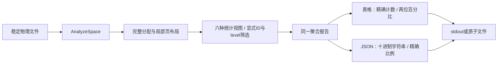

# 85. 统计报告：分配、索引层级与精确指标

## 学习目标与前置概念

把详细空间报告整理成六类统计视图，并能解释每个比例的分子、分母和认证范围。前置为[分配布局](75-space-allocation-layout.md)、[空间指标](76-space-analysis-validation.md)及[页内布局案例](81-visual-report-model.md#页布局与真实字节)。本章对应2026-10-12当前源码；固定标签v0.1.0不包含stats。

`stats.Build`每次调用一次`AnalyzeSpace`，随后只聚合已验证的内存字段。筛选影响输出组，仍检查整个文件；不额外解码列值、遍历schema相关父子键或跟随当前字段LOB引用。



## 原始字段与真实字节

贯穿样本`testdata/mysql8045/lesson_rows.ibd`为7页，共114688字节。页4同时为用户索引249的根和叶页，绝对起点`4 × 16384 = 65536`。以下位置均为**页内偏移**；字段使用大端序，实际字节来自固定夹具。

| 页内位置 | 长度 | 字节 | 解码与用途 |
|---|---:|---|---|
| +24 | 2 | `45bf` | 类型17855，INDEX |
| +34 | 4 | `00000028` | space ID40 |
| +38 | 2 | `0002` | 目录槽数2，每槽2字节 |
| +40 | 2 | `00ef` | heap top239 |
| +44 | 2 | `0000` | PAGE_FREE入口为空；入口偏移不是垃圾字节数 |
| +46 | 2 | `0000` | PAGE_GARBAGE字节数0 |
| +54 | 2 | `0004` | 用户记录链项数4，系统记录另占固定区域 |
| +64 | 2 | `0000` | level0，叶页 |
| +66 | 8 | `00000000000000f9` | index ID249 |

逐步计算：

1. heap记录区域起点为120，`HeapBytes = 239 - 120 = 119`。
2. `LayoutUsedBytes = 119 - 0 = 119`；删除标记记录仍留在这一布局中。
3. `DirectoryBytes = 2 × 2 = 4`；目录位于`[16372,16376)`，页尾占8字节。
4. `ContiguousFreeBytes = 16384 - 8 - 4 - 239 = 16133`。
5. `layout_occupancy = 119 / 16384`，表格显示`0.73%`；分母是完整物理页，分子包含本地记录开销，不等同SQL载荷。

文件中的5页used分别为FSP_HDR、IBUF_BITMAP、INODE、SDI和INDEX，另外2页free且全零。全零观察量与分配类别重叠，不能将`5 + 2 + 2`相加得到文件页数。

## 六种视图与指标口径

| 视图 | 分组 | 字段及计算 |
|---|---|---|
| summary | 文件，共一项 | file_pages/file_bytes；used/free/uninitialized/tail；zero_pages；index_count/segment_count；unknown_used_pages；used_share=used/file |
| page-types | 使用中页类型 | type_code/type_name；pages；bytes=pages×16384；share_of_used_pages=pages/UsedPages |
| indexes | index ID | kind按根页类型；root_page/height；pages/leaf_pages/internal_pages；叶链项、其中delete-mark项、未标记项；lob_allocated_pages |
| levels | index ID+level | 页数；记录链、delete-mark、PAGE_FREE链项；heap/layout/garbage/连续空闲/目录字节；布局占用率及单页min/max |
| segments | segment ID | 可空index ID；leaf/top/unassigned；used/reserved/reserved-unused；碎片页及free/partial/full区数量；used/reserved利用率 |
| regions | 连续物理页号区间 | first_page/end_page/pages；allocation；可信type/index/segment身份，可空 |

`file_bytes`是文件长度，不是稀疏文件实际磁盘块占用。未知使用中页保留类型编号，名称为`UNKNOWN`，单独计数；不计算其未知内部布局。页类型分母只含used页，free残留头不作为当前类型。

`internal_pages = pages - leaf_pages`。叶链项包括delete-mark，不包括PAGE_FREE；`leaf_non_deleted_records = leaf_linked_records - leaf_delete_marked_records`。SDI、聚簇和二级索引分别报告，不能累计成用户表行数。level大于0时记录链项表示导航记录。

布局平均比例为`Σ LayoutUsedBytes / (组页数 × 16384)`，min/max取单页分子。垃圾和连续空闲分别输出，二者之和仅表示页内可再利用观察量，不是可归还操作系统的空间。

段保留计数直接使用空间API。状态5租用区已扣除公共描述/位图页，末尾区按实际存在页计，不用“区数×64”重算。单叶根仍由top段分配；level0不意味着leaf段一定有页。LOB页数量表示段已分配的已知LOB/SDI_BLOB页，不保证仍被当前列引用。

区域为左闭右开`[first_page,end_page)`。只有相邻页的allocation相同，且used页的类型、可信索引和段身份均相同才合并。索引归属来自Index结构或已验证段归属。free/uninitialized/file-tail身份字段为null，不从残留页头推测；完整区域覆盖整个文件，描述物理连续性。

## 精确 JSON 与终端表格

数据JSON使用独立`schema_version=1`；**除该小版本号外，所有整数均为十进制字符串**。比例为`{"numerator":"119","denominator":"16384"}`；零分母返回null，表格显示`—`。表格计数/ID仍精确，百分比只在显示时舍入到两位。

封套包含`view/scope/complete/source/filter/validation/groups`。source的space_id/file_pages/file_bytes/page_size均为字符串；filter未指定成员为null，显式level0保留为`"0"`。scope固定为`allocation_and_local_index_layout`；validation标记allocation和used_page_integrity为true，tree_navigation和row_values为false。

以下为真实CLI页4层级数据的节选（省略单页min/max字段）；统计输出是一个JSON对象：

```json
{
  "schema_version": 1,
  "view": "levels",
  "scope": "allocation_and_local_index_layout",
  "complete": true,
  "source": {"space_id": "40", "file_pages": "7", "file_bytes": "114688", "page_size": "16384"},
  "filter": {"index_id": "249", "level": "0"},
  "validation": {"allocation": true, "used_page_integrity": true, "tree_navigation": false, "row_values": false},
  "groups": [{
    "index_id": "249", "level": "0", "pages": "1",
    "linked_records": "4", "delete_marked_records": "0", "free_list_records": "0",
    "heap_bytes": "119", "layout_used_bytes": "119", "garbage_bytes": "0",
    "contiguous_free_bytes": "16133", "directory_bytes": "4",
    "layout_occupancy": {"numerator": "119", "denominator": "16384"}
  }]
}
```

完整levels还输出`layout_occupancy_min/max`，本例均为119/16384。SDI索引ID`18446744073709551615`保持字符串，与用户索引249分开；判断SDI使用根页类型17853，不凭ID大小猜测。

排序：类型按页数降序、编号升序打破并列；索引按ID、层级按ID/level、段按ID、区域按起始页。排序在Go原始整数上完成，不能依赖JSON字符串的字典顺序。完整字段名见[报告类型](../../stats/report.go)。

## API、输出与失败边界

```go
id := uint64(249)
level := uint16(0)
report, err := stats.Build(ctx, reader, size, stats.Options{
    View: "levels", IndexID: &id, Level: &level,
    Space: innodb.SpaceOptions{MaxPages: 1000000, MaxEntries: 10000000},
})
if err != nil { return err }
return stats.WriteJSON(ctx, writer, report) // 或 WriteTable
```

调用方负责打开/关闭ReaderAt、gzip解压和快照稳定。报告只保留所选统计组，不复制Pages/Raw数组。Build失败返回nil；不存在的显式ID/level报错，筛选不会跳过其他使用中页损坏。

数据complete表示空间分析和聚合完成；stderr执行摘要还要求格式化/发布成功。stderr记录view、filter和实际physical_reads；成功分析得到的traversal_entries为计数，Build失败无法获得完整空间报告时为null。读次数包括失败的底层ReadAt调用；输出保护在分析前失败时不会伪造计数。诊断计数沿用CLI普通数字，数据JSON中的整数字符串契约独立。

聚合检查context并线性遍历，分组排序为O(G log G)。格式化也检查取消和短写；不能保证打断任意阻塞I/O。AnalyzeSpace保留全页元数据和未知页Raw，预算不是RSS硬上限。CLI的原子输出与输入别名保护沿用[第78章](78-cli-validation-and-failure.md)。更多命令示例见[CLI指南](../CLI.md#stats统计汇总与-json)。

代码入口：[聚合与类型](../../stats/report.go)、[表格与JSON](../../stats/write.go)、[CLI参数/诊断](../../internal/cli/stats.go)及[命令接入](../../internal/cli/run.go)。验证方法与边界见[第86章](86-statistics-validation.md)。
