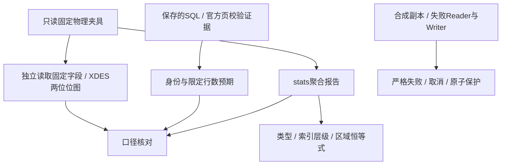

# 86. 统计验收：独立口径、精度与失败

## 学习目标与前置概念

证明统计字段可追溯到固定物理字节，区分独立预期和派生报告，并检查输出失败时的行为。先读[第85章指标模型](85-statistics-model-and-metrics.md)及[空间验收](76-space-analysis-validation.md)。本章说明统计验证方法，测试入口见[统计测试](../../stats/report_test.go)。



## 固定字节与独立预期

小表页4绝对起点65536，+40的大端`00ef`得到239，扣除起点120得到119字节heap；+46垃圾0，+38槽数2对应4字节目录，连续空闲为16133。测试固定期望119/0/16133/4和四条叶链项；字段表及计算见[第85章](85-statistics-model-and-metrics.md#原始字段与真实字节)。PAGE_FREE入口在+44，不能误当PAGE_GARBAGE。

特殊夹具逐页独立读取+24类型、+38目录槽、+40 heap top、+46垃圾、+54记录数、+64 level、+66 index ID；按原始ID/level汇总并核对布局、记录链计数和min/max。这里只复核固定宽度局部头字段，不新增列值解码器。

XDES描述页位于当前16384页组起点；组内第k个区描述位于页内`150 + 40×k`，位图始于描述+24，**每页2bit**，第一位表示free。按FSP_SIZE/FREE_LIMIT和原始位图独立累计used/free/uninitialized/file-tail，与summary核对。两位中的clean标志不参与free判断。

空间专用夹具的SQL身份、根页和受控行数来自保存的`.sql-metadata.json.gz`。grown与deleted分别对应17000和10条当前SQL行；SDI不参与用户行对照。官方CRC、页类型及独立位图证据见[原验收](76-space-analysis-validation.md#新快照与独立对照)和[testdata/space](../../testdata/space/README.md)。本次复用这些保存证据，没有重采集在线SQL或重跑官方工具。

## 样本与恒等式

[stats/report_test.go](../../stats/report_test.go)覆盖：

| 样本/输入 | 验证重点 |
|---|---|
| lesson_rows | 7=5+2页、用户叶链4项与SDI2项分开、119/16384、六个区域、空leaf段0/0 |
| secondary/empty | 空树保留单叶根与段身份，不把0条记录等同0页 |
| secondary/deep | 三层聚簇和二级树，levels导航项与叶项分别计数 |
| secondary/compact、compact/tree_compact_initial | COMPACT局部布局、跨页分组 |
| changes/lesson_marked、lesson_reused | delete-mark单独计数、PAGE_FREE与garbage单独计量 |
| space/grown、space/deleted | 跨16384页描述组、状态5租用区、未初始化页、大量空闲旧头、SQL身份/限定计数 |
| 合成未知类型 | 已使用LOB页改为65000并重封CRC，保留UNKNOWN编号/可信段与索引，不猜内部布局 |
| 合成free残留/归属边界 | 不同旧索引头仍合并free区间；used相邻不同身份不合并；未归属为null |

类型计数之和等于UsedPages；四类分配之和等于FilePages。按索引汇总levels页数等于Index.Pages，leaf页数等于LeafPages；叶链、删除与未标记项对应索引计数。`LayoutUsedBytes + GarbageBytes = HeapBytes`；完整区域无重叠且覆盖FilePages。段`used + reserved_unused = reserved`，状态5的62段页不被重算为64。

这些恒等式属于内部一致性检查，不能代替独立字节或SQL证据。合成输入只隔离错误/分组边界，不扩大版本、类型或布局兼容范围；原始物理夹具和保存报告保持指纹。

## 精度、排序与筛选

六视图的JSON经过通用解析器后，除schema_version外没有数字类型字段；SDI最大uint64精确保留为`"18446744073709551615"`。filter中未指定项为null，显式level0保持字符串。比例保留整数分子/分母，空段0/0为null；表格仅舍入显示百分比。

重复构建检查输出顺序稳定，合成不同页数检查页类型排序优先数量再按编号；索引、层级、段、区域的数值排序分别检查。显式不存在的索引或层级报错，非法筛选组合在读取前拒绝。筛选用户索引时损坏SDI仍失败，证明认证范围没有被筛选缩小。

## CLI、取消与发布失败

[internal/cli/stats_test.go](../../internal/cli/stats_test.go)逐个验证六视图的table/json、默认summary/table、SDI筛选和level0。stdout JSON恰好一个对象；stderr为独立执行摘要，小表实际读取7次、空间遍历104项，不将表格行数计作SQL行。

| 情况 | 预期 |
|---|---|
| 非法view/format、ID零/溢出/非十进制、错误level组合、row/manifest参数 | 退出2，stdout空 |
| 显式ID/level没有命中、CRC/读取错误、预算不足 | 退出1，不返回完整数据/发布文件 |
| 预先取消、读取中取消、输出中取消 | 返回context错误；CLI退出130 |
| Reader返回底层错误 | 保留errors.Is分类，Build返回nil |
| Writer短写/断管、stderr写失败 | 返回I/O错误，CLI非零；已有stdout前缀可能保留 |
| 已存在目标 | 默认失败，显式overwrite成功；失败保留原目标 |
| 目标为输入、硬链接或符号链接别名 | 拒绝，原输入保持 |
| 分析后输出失败 | 数据complete与执行complete分开解释；stderr complete=false |

与既有输出实现共用临时文件、同步/关闭、原子发布和清理规则。取消不保证打断任意阻塞调用，预算不等于进程内存限额；stats不增加行扫描预算或自动抽样。

## 复验命令与交付范围

在仓库根目录运行：

```sh
go test -race ./stats ./internal/cli -count=1
go test -race . -run '^TestSpace(Assets|Snapshots|Damage|Control|IdentityBounds)$' -count=1
go vet ./...
python3 scripts/check_docs.py
```

手工JSON/管道例子见[CLI指南](../CLI.md#stats统计汇总与-json)。必要时将GOCACHE设为可写临时目录；这只改变编译缓存，不改变输入。

当前stats提供六视图及精确输出。页布局/LSN分布、TopN、SDI名称映射、记录长度、目录owner、完整树扇出和当前LOB引用统计未在stats中实现，不能从其他入口的解析成功推定已提供这些统计。
