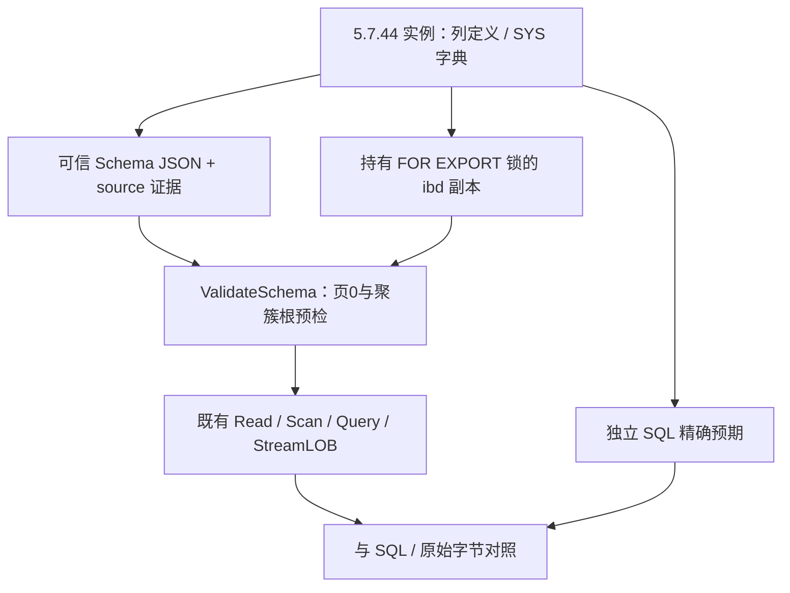

# 87. MySQL 5.7：显式元数据与真实文件读取

## 学习目标与前置概念

本章保留5.7.44首次验收的样本与说明；新增明确补丁范围及源码/实例对照见[第92章](92-mysql57-patch-compatibility.md)。

理解 5.7 的元数据入口、现有物理解码的复用边界和真实旧 BLOB 引用。先读[文件与页](02-file-to-page.md)、[旧 BLOB](65-compact-row-layout.md)及[流式完成契约](67-streaming-contract.md)。本章解释可信表定义与读取；二级与索引钻取见[第88章](88-mysql57-secondary-indexes.md)。验证报告见[表读取报告](../mysql57-validation/report.json)。



## 元数据入口与认证范围

5.7 使用 `.frm` 和 InnoDB 系统字典；8.0 将表定义迁入数据字典并在独立表空间保存 SDI。依据见[官方元数据文件说明](https://dev.mysql.com/doc/refman/8.0/en/data-dictionary-file-removal.html)与[SDI 说明](https://dev.mysql.com/doc/refman/8.0/en/serialized-dictionary-information.html)。5.7 的 `.ibd` 缺少现有自动入口需要的 SDI，ReadAuto/ScanAuto 不自动生成表定义。

`Schema` JSON 保持已有字段结构。采集脚本从 COLUMNS 获取列声明/字典、从 STATISTICS 获取 SQL 键成员、从 INNODB_SYS_INDEXES/FIELDS 获取实际聚簇身份与根页。无 PRIMARY 时先查看实际聚簇索引，区分唯一非空键与 GEN_CLUST_INDEX；不能按列顺序猜主键或固定根页为3。准确版本和原始元数据保存在 source JSON，schema 自身不证明源版本或事务时刻。

采集脚本仅接受 5.7.44 补丁、16 KiB、Single 非压缩非加密表空间及 DYNAMIC/COMPACT，拒绝 FULLTEXT/SPATIAL/索引化 VIRTUAL。版本判定保留原字符串并分离构建/日志后缀，真实5.7.44-log实例已验证；5.7源码set_server_version在开启日志时添加-log。还核对 SYS_TABLES.N_COLS 等于存储用户列数加三个系统列，发现全文索引删除后残留的隐藏 DOC_ID 等未公开物理列时拒绝。此项核对来自 5.7 的 `i_s_dict_fill_sys_tables`，不能推广为所有未来版本的列计数规则。

`ValidateSchema(io.ReaderAt, size, Schema)` 校验 schema 属性、页0 CRC/LSN/身份/flags，以及聚簇根的 CRC/LSN/索引身份/局部布局/无兄弟关系，共读取两页。它不遍历子树或解码列值；可信 schema 的逻辑定义仍由调用方保证，无法检测全部同宽列错配。metadata 显式输出 `source=explicit_schema` 和 schema，不构造伪 SDI 身份；行/查询认证由后续扫描完成。

CLI 的 schema 输入最多1 MiB，须为一个 UTF-8 JSON 对象；拒绝未知字段、重复键、大小写别名重复、非 ASCII 属性名、显式 null 和尾随对象。可选属性省略，SQL NULL 通过列的 nullable 与记录位图表示。预检页请求从扫描预算中扣除；schema 文件及其硬链接/符号链接别名属于受保护输入。

## 表空间与索引页：真实字节

所有下表偏移均为页内偏移，整数使用大端；以[固定夹具目录](../../testdata/mysql5744/README.md)的 scalar_dynamic_initial 和 scalar_compact_initial 为例。

| 偏移 | 长度 | 字段 | 真实值与解释 |
|---|---|---|---|
| 页0 +24 | 2 | FIL_PAGE_TYPE | `00 08`，FSP_HDR |
| 页0 +34 | 4 | FIL space ID | DYNAMIC为43，COMPACT为52；与外部 schema 核对 |
| 页0 +54 | 4 | FSP_SPACE_FLAGS | DYNAMIC=`00 00 00 21`，COMPACT=`00 00 00 00` |
| 根页 +24 | 2 | 页类型 | `45 bf`，普通 INDEX=17855 |
| 根页 +64 | 2 | PAGE_LEVEL | scalar为0；tree_dynamic_initial为2，实际三层树 |
| 根页 +66 | 8 | PAGE_INDEX_ID | scalar DYNAMIC为60，COMPACT为69 |

本组聚簇根为页3，绝对起点为 `3 × 16384 = 49152`；它来自系统字典。DYNAMIC 的 bits0/5 表示对应行格式特征，COMPACT 为零，PAGE_SSIZE零表示传统16 KiB；SDI bit14未设置。其他组合依既有严格表空间检查处理，不能因为有相同页头常量就宣布兼容。

## 旧 BLOB：引用、前缀与页链

lob_compact_initial 的第一行 txt 引用位于聚簇页内921，前面是768字节本地前缀，20字节引用原文为：

```text
00000035 00000009 00000026 00000000 00010e70
```

| 引用相对偏移 | 长度 | 含义 | 解码 |
|---|---|---|---|
| +0 | 4 | space ID | `0x35`=53 |
| +4 | 4 | 首个页号 | 9 |
| +8 | 4 | 旧 BLOB header offset | `0x26`=38 |
| +12 | 4 | 长度高位/生命周期标志 | 本例为0 |
| +16 | 4 | 页外后缀字节数 | `0x10e70`=69232 |

实际首个页9中，+24页类型为10，+38..45为 `00 00 3f ca 00 00 00 0a`。+38的长度为16330，+42的下一页为10，+46开始为载荷。最大单块为 `16384 − 8 − 38 − 8 = 16330` 字节；沿 next 读取至 FIL_NULL，累计后缀长度必须等于69232，完整值为 `768 + 69232 = 70000` 字节。

页9载荷起始16字节为 `98 80 e7 95 8c f0 9f 98 80 e7 95 8c f0 9f 98 80`；前两字节接续本地前缀中的 UTF-8 字符。StreamLOB 提供原始块，不能逐块当完整 UTF-8 字符串解码。DYNAMIC 引用没有 COMPACT 的768字节前缀，两种行格式均按实际首个页类型分派至旧链；原引用+8在该格式表示偏移，公开解析结果使用 HeaderOffset=38、Format=BLOB。

引用和页链规则对照只读 5.7.44 `btr0cur.cc` 的 BTR_BLOB_HDR_PART_LEN/NEXT_PAGE_NO/SIZE 及写入路径；Go 复用[compact.go](../../compact.go)、[lob.go](../../lob.go)和[stream_lob.go](../../stream_lob.go)，本批未修改列/记录/LOB 解码实现。

## 列值与独立预期

固定样本覆盖现有数值、日期时间、文本/二进制、ENUM/SET、JSON、七种二维几何值及 NULL 的代表组合；含整数有符号/无符号边界、DECIMAL(65,30)、BIT(64)、时间fsp6和零值、四种受支持字符集。LOB样本包含初始、多列多页、增长、缩短/删除及全部 TEXT/BLOB 类型；另有空树、三层复合 VARBINARY 键、隐藏 ROW_ID、实际唯一聚簇键和 STORED/VIRTUAL。

独立 SQL 预期由实例查询保存：DECIMAL/日期时间显式字符串，二进制为HEX，BIT/YEAR显式无符号数，几何为SRID和官方ST_AsBinary。5.7 的 JSON_ARRAY(YEAR) 会产生 opaque/base64表示，因此采集时使用 CAST AS UNSIGNED。JSON原生值与 SQL NULL 分开，读取后按精确数字规范化对象，不通过float64比较 uint64。

每个固定物理文件的 SHA256 在 manifest 中，SQL预期/原始字典/DDL和 writer SQL 一起保存。ReadMaterialized 与 ScanMaterialized 分别对照SQL；新样本也加入原有整表扫描、聚簇点查/范围/反序和两种 rowio codec 矩阵，8.0样本继续走SDI路径。物理结果间的互相比较仅为一致性证据。

## 代码入口、验证与边界

- [ValidateSchema](../../schema_check.go)、[CLI schema输入](../../internal/cli/schema.go)与[CLI主入口](../../internal/cli/run.go)。
- [Go采集子命令](../../internal/mysql57/collect.go)、[独立采集脚本](../../scripts/mysql57_schema.py)、[真实夹具生成](../../scripts/generate_mysql57_fixtures.py)和[不支持布局验证](../../scripts/verify_mysql57_schema.py)。
- [5.7 SQL/字节/损坏测试](../../mysql57_test.go)、[CLI及输入fuzz](../../internal/cli/schema_test.go)。

损坏测试只修改副本：BLOB环、空块、错空间/类型和 schema身份矛盾；结构实验重新封装CRC，独立CRC损坏实验保持错误CRC。完整Read不返回部分结果，流式错误保持Complete=false。VIRTUAL默认拒绝，--materialized仅返回存储列和单独定义，不补伪NULL。

page/space/stats和默认空间HTML通过真实5.7输入验证，认证范围仍分别是空间分配/局部布局或所选路径。CRC独立对照使用本机官方8.0.45 innochecksum；镜像未提供5.7 innochecksum。A批不包含二级元数据/查询、索引钻取、分区集合、纯离线.frm字典发现、其他5.7补丁、其他页大小、压缩/加密或恢复。代表类型样本不证明所有宽度、DDL/DML和类型组合；详细版本范围见[支持矩阵](83-release-support-matrix.md#mysql-5744-显式元数据扩展)。
