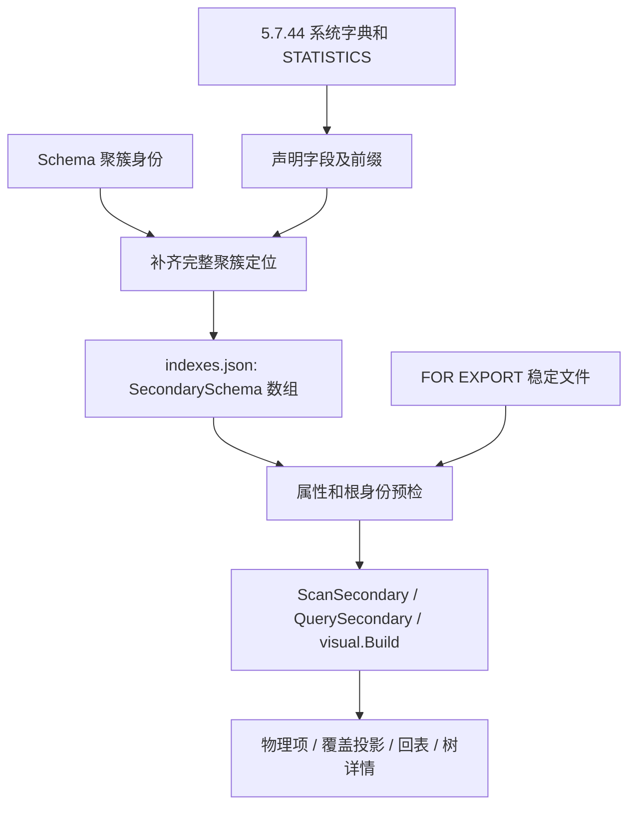

# 88. MySQL 5.7：二级元数据、查询与索引钻取

## 学习目标与前置概念

本章保留5.7.44首次验收的样本与说明；新增明确补丁范围及源码/实例对照见[第92章](92-mysql57-patch-compatibility.md)。

理解没有 SDI 时如何取得二级物理字段，区分声明前缀、实际载荷与聚簇定位，复核覆盖查询、按需回表和三层树。先读[第87章](87-mysql57-explicit-schema.md)、[二级物理布局](71-secondary-record-layout.md)与[二级投影查询](73-secondary-query-navigation.md)。本章解释可信二级定义与查询，验证数据见[二级验证报告](../mysql57-validation/secondary/report.json)。



## 声明字段与完整物理键

`INNODB_SYS_INDEXES` 的 INDEX_ID、SPACE、PAGE_NO 提供实际身份。5.7.44 的 SYS_FIELDS 和 N_FIELDS 提供声明的字段，不能把它们直接作为二级页完整布局。固定 composite_dynamic 表声明：

```sql
PRIMARY KEY(k,id),
KEY px(k(3),name(2)),
KEY dedup(n,k,id),
KEY s(n)
```

其中 k 是 VARBINARY(24)，name 是 utf8mb4_bin VARCHAR(40)。原始字典中 px 只有 k、name 两项；实际记录有四项：

| 物理位置 | 原表列位置 | 字段 | PrefixBytes | 用途 |
|---|---|---|---|---|
| 0 | 0 | k | 3 | 声明二进制前缀 |
| 1 | 3 | name | 8 | 声明2字符 × 最大4字节 |
| 2 | 0 | k | 0 | 追加完整聚簇键 |
| 3 | 1 | id | 0 | 追加完整聚簇键 |

因此 `UserFields=2`、`ClusteredFields=[2,3]`。k 的前缀与完整 k 可以在同一个物理项中重复出现。dedup 已声明完整 k/id，定位直接引用已有字段，不再追加；仅非空、完整字段可以被复用。没有用户聚簇键时追加 `Column=-1, RowID=true`、BINARY(6) 的 DB_ROW_ID，不能把它变成 SQL 用户列。

规则核对只读官方5.7.44源码 `storage/innobase/dict/dict0dict.cc:3452–3548` 的 dict_index_build_internal_non_clust：先复制声明字段，只标记 prefix_len=0 的列，再依聚簇顺序追加未包含的列；唯一二级的 n_uniq 是声明项数，非唯一是完整物理项数。原始视图定义另见 `storage/innobase/handler/i_s.cc` 的 i_s_dict_fill_sys_indexes / i_s_dict_fill_sys_fields。源码结论与实际字典、SQL预期分别保存，字典视图不是解析器输出。

SQL SUB_PART 对字符键表示字符数，对二进制键表示字节数。采集器按 utf8mb4/utf8/ascii/latin1 的最大编码宽度转换；全宽前缀规范化为完整字段。Definition 保留原列类型/容量，并带该索引的排序规则。5.7 声明 DESC 不产生8.0的物理降序，本组声明 s(n DESC) 的 STATISTICS 和页面均为 ASC；采集器保存实际方向，不照抄 DDL 的 DESC。

## 索引文件契约与预检

schema.json 沿用第87章。配套 indexes.json 是既有 SecondarySchema 的 JSON 数组，外层字段名沿用 Go 模型，内嵌 Definition 沿用 Column 的标签。下例为结构示意，容量、列号和身份须取自对应表：

```json
[
  {
    "Name": "s",
    "Unique": false,
    "RowFormat": "DYNAMIC",
    "SpaceID": 134,
    "IndexID": 242,
    "RootPage": 6,
    "Fields": [
      {"Column":2,"Definition":{"name":"n","type":"INT","nullable":true},"PrefixBytes":0,"RowID":false},
      {"Column":0,"Definition":{"name":"k","type":"VARBINARY","max_bytes":24},"PrefixBytes":0,"RowID":false},
      {"Column":1,"Definition":{"name":"id","type":"INT"},"PrefixBytes":0,"RowID":false}
    ],
    "UserFields": 1,
    "ClusteredFields": [1,2]
  }
]
```

CLI 最多读取1 MiB、一个 UTF-8 数组，拒绝未知属性、显式null、尾随值、重复属性及大小写别名重复、非ASCII属性名；属性值/索引名可为Unicode。空数组有效，表示未提供二级定义。定义须匹配表空间/行格式、原列类型与聚簇定位；索引名称、ID、根页不能与同列表或聚簇身份重复。文件可信来源和完整索引集合仍由调用方保证，预检不能证明遗漏索引或所有同宽列错配。

`ValidateSecondarySchemas(r,size,table,indexes)` 先检查全部定义，再读取页0及每个根，核对CRC、身份、局部页结构和无兄弟关系。N个非空目录读取N+1页；空数组不读页。聚簇根由 ValidateSchema 单独认证，所以 CLI 完整预检为 N+3 页请求。metadata 可以报告定义与根身份，不能用它的成功代替完整扫描。

query/check secondary 的 `--max-page-reads` 在扣除预检后传给原扫描器。visual.Build 的显式预检也扣除 Scan.MaxPageReads；空间分析、预检、扫描及原始页读取共同计入 MaxReadCalls。最终报告的 ScanReport 只计扫描层请求，CLI stderr 的 preflight_reads 单独保存预检成本。坏的未选索引也使整个显式目录失败，调用方可提供所需的受支持子集。

## 真实记录逐字节解码

以固定 composite_dynamic 的 px 为例：space134、index240、根页4、level0。页4起点为 `4×16384=65536`。下列记录 Start=120、Origin=129、End=147，id=1；原文来自[派生字节报告](../mysql57-validation/secondary/bytes.json)，可用[固定原始文件](../../testdata/mysql5744-secondary/README.md)复核：

```text
04 07 03 00 | 00 00 10 00 1b | 61 62 63 | e7 95 8c f0 9f 98 80 | 61 62 63 01 | 80 00 00 01
```

| 页内偏移 | 长度 | 含义 | 解释 |
|---|---|---|---|
| 120 | 1 | 第2项完整 k 的变长长度 | 04，4字节 |
| 121 | 1 | 第1项 name 前缀长度 | 07，实际7字节 |
| 122 | 1 | 第0项 k 前缀长度 | 03，3字节 |
| 123 | 1 | nullable name 的位图 | 00，非NULL |
| 124 | 5 | compact记录头 | heap2、普通项、next相对偏移27 |
| 129 | 3 | k 前缀 | 616263，即abc |
| 132 | 7 | name 前缀 | UTF-8的界😀，2字符；声明最大8字节不等于本项长度 |
| 139 | 4 | 完整 k | 61626301 |
| 143 | 4 | id | 大端80000001，去符号翻转后为1 |

Origin 的绝对偏移为65665。变长长度逆序保存，定位后缀也参与长度区；本例没有12/7字节事务字段，二级项不能伪装完整聚簇行。

同页 id=3 的 name 是NULL：Start174、Origin182，头前原文 `01 01 01` 表示两项 k 长度各1字节和 NULL 位图01；NULL name 不占载荷或长度字节。SQL NULL 与长度0的空字符串分别验收。

hidden_dynamic 的 s 首项只有 NULL seq 和六字节 `00 00 00 00 02 1e`，ROW_ID 为542。SQL 无法直接读取隐藏 ROW_ID，所以 SQL 独立比较用户字段多重集合；ROW_ID 原始字节和二级到聚簇定位一致性另行核对，不称为SQL独立身份预期。

## 查询与可视化的认证范围

二级查询的边界仍作用于完整声明列值，Prefix 是完整前导列相等，不是字符串前缀匹配。前缀索引可返回同前缀的其他值；例如 ordinary_dynamic 的 name(3) 包含 abc-one/abc-two，查 abc-two 需回表比较，不能仅见abc就交付。投影完全在完整物理字段中且不需获取前缀原值时可覆盖；需要 payload 或完整前缀列时按聚簇定位回表。ProjectedRow 分别保存 SecondaryPage/Offset 和可选 ClusteredPage/Offset，Covered 不认证聚簇树。

tree_dynamic 与 tree_compact 的 secondary 根均在页4、level2，实际各50个访问页、49条父子边、800个项；根的 +64 为level、+66为8字节大端index ID。三层树通过原有父子范围/兄弟链/局部记录校验，HTML同样显示树、字段定义、所选记录字节；物理来源中的 MetadataSource=explicit_schema 与8.0的sdi来源区分。

visualize 对聚簇树使用实际聚簇名字，隐式身份分别为 actual / GEN_CLUST_INDEX，不能一概指定PRIMARY。VIRTUAL 存在时聚簇树需 `--materialized`；二级物理扫描不求值VIRTUAL，可以单独读取，但二级表投影仍须明确选择仅物化视图。

## 验证、入口与边界

- [采集脚本](../../scripts/mysql57_schema.py)增加显式 `--indexes`，配套schema/indexes/source和可选FOR EXPORT快照；默认保持A批输出。
- [索引预检](../../schema_check.go)、[CLI严格输入](../../internal/cli/schema.go)、[CLI执行](../../internal/cli/run.go)和[报告构建](../../visual/report.go)复用既有模型/解析器，无新依赖。
- [真实生成SQL](../../scripts/generate_mysql57_secondary_fixtures.py)、[独立SQL及损坏/预算测试](../../mysql57_secondary_test.go)、[CLI测试](../../internal/cli/indexes_test.go)、[全部显式索引报告测试](../../visual/mysql57_test.go)。
- [真实采集拒绝实验](../../scripts/verify_mysql57_secondary_schema.py)与[原始执行证据](../mysql57-validation/secondary/report.json)。

真实SQL保存完整二级物理项的可见字段，以及覆盖/完整投影、NULL/重复键、完整范围、点查、前导等值、反序/Limit预期。隐藏身份相关SQL比较采用多重集合；来自同一物理输入的Read/Scan/HTML比较只作一致性证据。新夹具加入整表/聚簇查询/空间和JSONL/CSV原有矩阵；8.0仍使用SDI。

失败实验只修改副本，涵盖重复身份、错列/前缀/定位、根兄弟、CRC/深层损坏、预算、回调停止、I/O、取消、输入别名保护及原子输出。根局部预检可以在后代CRC损坏时成功，随后完整Read返回nil，Scan可已交付前缀但Complete=false。官方独立CRC工具是本机8.0.45 innochecksum，不能表述成5.7工具验证。

5.7.44扩展代表组合不证明所有键类型、宽度、DDL/DML和补丁。二级当前证据限本章固定样本，不扩展FULLTEXT/SPATIAL/索引化VIRTUAL、分区集合、物理DESC、原生INSTANT/INVISIBLE、其他页大小、压缩/加密、恢复或.frm自动发现。准确已验证范围见[支持矩阵](83-release-support-matrix.md#mysql-5744-显式元数据扩展)。
