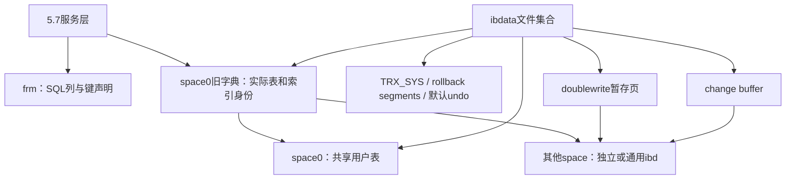

# 89. MySQL 5.7 系统表空间：字典、事务与共享存储

## 学习目标、版本与阅读边界

本章用 **5.7.44、16 KiB、未加密系统表空间** 解释 `ibdata1` 的职责、固定入口页和实际字节。先读[文件与页](02-file-to-page.md)、[页校验](39-page-checksum.md)、[表空间分配](75-space-allocation-layout.md)及[5.7显式元数据](87-mysql57-explicit-schema.md)。8.0.45 的迁移和保留结构单独见[第90章](90-mysql80-system-tablespace.md)。

读完应能区分：物理文件与逻辑表空间、表定义与索引身份、已落盘页与事务可见性，以及“观察了字段”与“完成恢复”。本章是知识教材；当前 Go 读取器仍不支持系统表空间、旧字典自动发现或事务恢复。

依据有三类：用户提供的官方5.7.44源码、官方版本手册、[本章独立实例样本](../system-tablespace-validation/README.md)。固定偏移是源码定义；页数、ID、根页和十六进制是本次样本观察，不能推广为所有实例。工具核对使用官方 **8.0.45** innochecksum，不能称为5.7工具验收；该工具对旧双写区域有跳过规则，不能据通过结果认证全部复制页。

## 系统表空间是什么

InnoDB 的 **space ID=0** 表示系统表空间。`ibdata1` 是默认文件名，配置 `innodb_data_file_path` 可指定多个文件；文件路径、顺序和容量共同组成同一个逻辑地址空间。[官方系统表空间说明](https://docs.oracle.com/cd/E17952_01/mysql-5.7-en/innodb-system-tablespace.html)

| 内容 | 5.7中的作用 | 是否等同用户当前行 |
|---|---|---|
| 系统字典 | 表/列/索引/外键、实际表空间与根页对应关系 | 否，是元数据 |
| TRX_SYS与回滚段 | 事务编号、rollback segment入口与undo管理 | 否，需要事务语义解释 |
| undo | 回滚修改、MVCC旧版本及purge历史；默认在系统空间，可配置独立undo空间 | 否，不是完整历史备份 |
| change buffer | 尚未合并到目标二级页的变更 | 否，是待应用操作 |
| doublewrite | 刷盘中完整页的暂存副本 | 否，是循环复用的恢复材料 |
| 用户表/索引/LOB | 表创建在系统空间时，其物理存储位于这里 | 是目标表的一部分，需正确定位 |
| FSP/XDES/INODE和编号头 | 页、区、段分配以及内部编号分配状态 | 否，是存储管理信息 |

启用 `innodb_file_per_table` 后新建的普通独立表，其数据和索引进入自己的 `.ibd`；系统字典等共享信息仍存在。更改开关不会自动搬迁所有既有表。通用表空间是另一种共享空间，也不能与space0混为一谈。



`.frm` 中的SQL定义与InnoDB字典部分重叠；字典负责内部对象和物理归属，不能把 `.frm` 的服务层记录偏移直接当作InnoDB行内偏移。[官方字典说明](https://docs.oracle.com/cd/E17952_01/mysql-5.7-en/innodb-data-dictionary.html)

## 多文件、页号与字节序

设页大小为P，配置顺序中第i个文件之前累计有Bᵢ页，其物理长度为Nᵢ页。逻辑页q满足 `Bᵢ ≤ q < Bᵢ+Nᵢ` 时：

```text
目标文件 = i
文件内偏移 = (q - Bᵢ) × P
页内偏移 = 某字段相对该页的偏移
```

这是多文件映射示意；本章真实样本只有一个 `ibdata1`，所以文件偏移为 `q×16384`。不能对第二个文件继续使用 `q×P`，也不能按文件名排序替代配置顺序。页0的FSP_SIZE表示逻辑表空间页数，可能大于第一个文件单独的页数。

下文整数均按InnoDB的 **大端** 解码。FIL头长38字节，页尾8字节用于校验/LSN；这些共同结构见第02/39章。`FIL_PAGE_OFFSET` 位于页内+4，`FIL_PAGE_TYPE` 位于+24，`FIL_PAGE_SPACE_ID` 位于+34。doublewrite复制页有特殊身份规则，见后文。

## space0最前面的固定入口

源码 `fsp0types.h` 定义space0页3–7的特殊用途；页0–2是表空间分配基础。根地址和段地址继续从这些入口读取，不能把之后的所有页都当作系统字典。

| 逻辑页 | 单文件绝对起点 | 样本页类型 | 用途 |
|---:|---:|---|---|
| 0 | 0 | 8，FSP_HDR | 空间头与首组XDES |
| 1 | 16384 | 5，IBUF_BITMAP | 对应页组的change-buffer位图 |
| 2 | 32768 | 3，INODE | 第一张段管理页 |
| 3 | 49152 | 6，SYS | change buffer段头 |
| 4 | 65536 | 17855，INDEX | change buffer B-tree根 |
| 5 | 81920 | 7，TRX_SYS | 事务系统头 |
| 6 | 98304 | 6，SYS | 首个系统回滚段头 |
| 7 | 114688 | 6，SYS | 旧字典入口和编号头 |

“SYS=6”是一般内部系统页类型，不能仅凭类型6区分页3、6、7的载荷。用途还需结合版本、固定入口和引用关系。首组之后的XDES/IBUF_BITMAP按覆盖范围重复，不能把所有位图页都理解为页1。

### 页0：共享分配头的真实字节

样本页0从+38开始的24字节：

```text
00000000 00000000 00001300 00000240 00000000 00000042
space0   reserved size4864 limit576 flags0   frag_used66
```

| 页内偏移 | 长度 | 字段 | 本例 |
|---:|---:|---|---|
| 38 | 4 | FSP_SPACE_ID | 0 |
| 46 | 4 | FSP_SIZE | 4864页，文件为79691776字节 |
| 50 | 4 | FSP_FREE_LIMIT | 576，已初始化分配管理的边界 |
| 54 | 4 | FSP_SPACE_FLAGS | 0 |
| 58 | 4 | FSP_FRAG_N_USED | 66，特定空间碎片链的计数 |

flags=0不能推出这里所有表都是REDUNDANT：本例系统字典是REDUNDANT，`lesson/shared_rows` 却是COMPACT。共享空间里，表的行格式要结合表级字典和索引页验证。FSP_FRAG_N_USED不是全空间“使用中页总数”；后续FREE/FREE_FRAG/FULL_FRAG、INODE和XDES的字段解释复用第75章，不能把独立文件的支持限制放宽后就当成系统解析器。

## 页7：从编号头找到旧字典树

`DICT_HDR=FSEG_PAGE_DATA=38`。下表偏移都已换算成页内偏移：

| 页内偏移 | 长度 | 字段 | 样本值 |
|---:|---:|---|---:|
| 38 | 8 | DICT_HDR_ROW_ID | 10 |
| 46 | 8 | DICT_HDR_TABLE_ID | 45 |
| 54 | 8 | DICT_HDR_INDEX_ID | 44 |
| 62 | 4 | DICT_HDR_MAX_SPACE_ID | 24 |
| 66 | 4 | 旧MIX_ID字段 | 10 |
| 70 | 4 | SYS_TABLES聚簇根 | 8 |
| 74 | 4 | SYS_TABLE_IDS二级根 | 9 |
| 78 | 4 | SYS_COLUMNS聚簇根 | 10 |
| 82 | 4 | SYS_INDEXES聚簇根 | 11 |
| 86 | 4 | SYS_FIELDS聚簇根 | 12 |
| 94 | 10 | 字典头所在段的FSEG引用 | 按space/page/offset拆解 |

+38..89原文为：

```text
000000000000000a 000000000000002d 000000000000002c
00000018 0000000a 00000008 00000009 0000000a 0000000b 0000000c
```

编号字段是持久化分配状态，部分编号采用批量持久化/启动跳跃规则；它们不是SQL AUTO_INCREMENT当前值，也不能充当提交事务清单。

逐步定位SYS_INDEXES：

1. 读取space0页7，核对固定入口页和CRC/LSN。
2. 从页内+82读取 `00 00 00 0b`，得到根页11；该字段文件绝对偏移为114770。
3. 定位页11，单文件起点为180224；观察类型17855、PAGE_INDEX_ID=3和PAGE_LEVEL=0。
4. 检查PAGE_N_HEAP的compact标志。本例未设置，使用REDUNDANT记录格式；不能交给当前compact解码器强行读取。
5. 按SYS_INDEXES的硬编码系统表定义解码记录，再以目标TABLE_ID筛选，结合SPACE/PAGE_NO定位用户索引。

第1–3步和SQL根身份已在本次固定样本核对；第4步观察已记录。第5步是未来完整字典解析所需流程，本项目尚未实现。

### 字典表分别补齐什么

| 内部表 | 关键字段/关系 | 用途 |
|---|---|---|
| SYS_TABLES | NAME、ID、N_COLS、TYPE、SPACE | 名称映射到内部表ID及物理布局 |
| SYS_TABLES的ID_IND | 表ID反查NAME | 页7中SYS_TABLE_IDS指向这棵二级树，不是另一张独立表 |
| SYS_COLUMNS | TABLE_ID、POS、NAME、MTYPE、PRTYPE、LEN、PREC | 内部列类型与存储属性 |
| SYS_INDEXES | TABLE_ID、ID、NAME、N_FIELDS、TYPE、SPACE、PAGE_NO | 索引名、身份、类型和实际根 |
| SYS_FIELDS | INDEX_ID、POS、COL_NAME | 声明的索引成员；物理后缀构造见第88章 |
| SYS_FOREIGN / SYS_FOREIGN_COLS | 外键与列对应 | 约束定义，不能只靠.frm补齐 |
| SYS_TABLESPACES / SYS_DATAFILES | 表空间元数据和路径 | 文件归属/外置路径 |
| SYS_VIRTUAL | 虚拟列与基列关系 | 不等于完整表达式求值器 |

最初几张系统表采用引擎硬编码定义完成bootstrap；其他系统表的发现不能随意套用页7前五个根字段。SYS_COLUMNS也不能代替.frm中的ENUM/SET标签、完整SQL声明和生成表达式。

本例SQL独立报告如下：

| 表 | 索引 | space ID | index ID | 根页 |
|---|---|---:|---:|---:|
| lesson/shared_rows | PRIMARY | 0 | 41 | 347 |
| lesson/shared_rows | n_idx | 0 | 42 | 348 |
| lesson/private_rows | PRIMARY | 23 | 43 | 3 |
| lesson/private_rows | n_idx | 23 | 44 | 4 |

根页347的起点为5685248。名称到内部索引ID的对应关系由SQL字典提供，根页头则独立验证ID和space；不能从页头倒推出SQL索引名称。无显式主键时，实际唯一非空聚簇键或GEN_CLUST_INDEX也应由字典核实。

## 页5与页6：事务入口、回滚段和undo

页5的 `TRX_SYS=38`：

| 页内偏移 | 长度 | 含义 |
|---:|---:|---|
| 38 | 8 | 持久化事务编号分配值 |
| 46 | 10 | 事务系统段FSEG引用 |
| 56+i×8 | 4 | 第i个rollback segment槽的space ID |
| 60+i×8 | 4 | 同槽的rollback segment头页号 |

5.7当前槽数为128，页号FFFFFFFF表示空。槽中的space ID可以指向独立undo表空间，所以“事务入口在ibdata1”不等于“所有undo都在ibdata1”。

本例+38的8字节是 `0000000000000700`，即1792；槽0原文 `00000000 00000006` 指向space0页6。该编号不是“截至1792全部事务已提交”的证据。

页6从+38开始是TRX_RSEG头：MAX_SIZE位于38（4字节），HISTORY_SIZE位于42（4字节），历史链基节点位于46（16字节），FSEG引用位于62（10字节），undo segment槽从72开始，每槽4字节页号。历史链计数、undo槽、活动/缓存undo以及purge状态具有不同含义，不能合计成SQL行数。

undo中的修改前信息用于构造旧版本或回滚；记录里的DB_ROLL_PTR只是定位线索。要判断某个读视图可见的行，还需要事务状态/读视图及正确的undo解释。purge会释放不再需要的历史，undo不保证保留所有已删除数据。[官方Undo表空间说明](https://docs.oracle.com/cd/E17952_01/mysql-5.7-en/innodb-undo-tablespaces.html)

## Change Buffer：单个.ibd可能缺少的二级变更

页3保存change buffer段入口，页4是共享B-tree根；它存储以目标space/page及操作信息组织的二级变更。各表空间的IBUF_BITMAP表示相关页的缓冲状态和空间级别，位图本身不包含完整操作内容。

这些操作可以在事务提交后仍未合并，也可能跨普通关闭/重启保留。因此“文件不再变化”或“服务正常关闭”不能单独证明每棵二级树已经反映所有已提交变更。[官方Change Buffer说明](https://docs.oracle.com/cd/E17952_01/mysql-5.7-en/innodb-change-buffer.html)

本项目的FOR EXPORT单表采集走 `row_quiesce_table_start`：停止相关purge推进、合并该表change buffer，再刷出相应页。源码流程见 `row0quiesce.cc`；这也是第87/88章受控快照使用条件的一部分。仅读IBUF_BITMAP或者CRC成功，不能宣称完成了change-buffer应用。

## Doublewrite：页5尾部入口与复制页身份

5.7的双写暂存区位于系统空间，用于保存写入目标文件之前的完整页副本。[官方Doublewrite说明](https://docs.oracle.com/cd/E17952_01/mysql-5.7-en/innodb-doublewrite-buffer.html)

16 KiB下入口基址为 `P−200=16184`，位于页5内；它不是从+38开始的TRX_SYS相对偏移。FSEG_HEADER_SIZE=10：

| 页内偏移 | 长度 | 字段 | 样本值 |
|---:|---:|---|---|
| 16184 | 10 | 双写段FSEG引用 | 按space/page/offset拆解 |
| 16194 | 4 | MAGIC | 1fffbd5f=536853855 |
| 16198 | 4 | BLOCK1起始页 | 00000040=64 |
| 16202 | 4 | BLOCK2起始页 | 00000080=128 |
| 16206 / 16210 / 16214 | 各4 | MAGIC/BLOCK1/BLOCK2重复副本 | 与上面对应字段一致 |
| 16218 | 4 | SPACE_ID_STORED标记 | 6a5073aa |

两块各64页；具体起点须从入口读取，不硬编码64/128。MAGIC的文件绝对偏移为98114。完整入口原文在observations.json中，本例关键三字段为：

```text
1fffbd5f 00000040 00000080
```

**复制页的FIL身份属于目标页，不属于双写槽。** 本例物理页64内的FIL_PAGE_OFFSET是5；物理页66内是314。不能强制要求“物理页64的页头也必须写64”。真实恢复还要按目标space/page匹配、核对校验和、LSN与日志，不能把双写区复制项当作新的用户记录。它循环复用，不是所有页面或历史版本的备份。

## 何时需要系统表空间

| 任务 | 所需信息 |
|---|---|
| 读取已受控采集的独立.ibd，已有完整可信schema/indexes | 当前入口可以不访问ibdata |
| 从.frm提取SQL列/键声明 | 不必读取系统空间；物理身份仍需其他来源 |
| 无服务端/外部映射，离线查实际索引名、ID和根 | 需要正确版本、匹配时点的系统字典 |
| 目标数据位于space0 | 必须读取相应系统空间文件 |
| 合并仍被缓冲的二级变更 | 需要change buffer及目标索引页，并正确应用操作 |
| 回滚、MVCC或崩溃恢复 | 需要相关系统/undo/redo及其他一致输入；本项目未实现 |
| 利用doublewrite修复部分页写入 | 需要仍可用且匹配的复制页，不能保证总能找到 |

Redo默认是独立的ib_logfile0/1，临时空间也有自己的文件；不在本章把这些都归入ibdata。[5.7 Redo说明](https://docs.oracle.com/cd/E17952_01/mysql-5.7-en/innodb-redo-log.html) 多文件集合和.frm/ibd/sys字典须匹配来源与时点。这里的流程解释不提供直接覆盖文件、删除文件或生产恢复命令。

## 源码入口与验证方式

| 5.7.44源码 | 本章核对点 |
|---|---|
| [fsp0types.h](https://github.com/mysql/mysql-server/blob/mysql-5.7.44/storage/innobase/include/fsp0types.h#L157) | space0固定页号 |
| [dict0boot.h](https://github.com/mysql/mysql-server/blob/mysql-5.7.44/storage/innobase/include/dict0boot.h#L146) | 字典头偏移、系统表列/物理字段定义 |
| [dict0boot.cc](https://github.com/mysql/mysql-server/blob/mysql-5.7.44/storage/innobase/dict/dict0boot.cc#L369) | 字典bootstrap及根引用 |
| [trx0sys.h](https://github.com/mysql/mysql-server/blob/mysql-5.7.44/storage/innobase/include/trx0sys.h#L439) | 事务槽及双写头 |
| [trx0rseg.h](https://github.com/mysql/mysql-server/blob/mysql-5.7.44/storage/innobase/include/trx0rseg.h#L240) | 回滚段头与undo槽 |
| [ibuf0ibuf.cc](https://github.com/mysql/mysql-server/blob/mysql-5.7.44/storage/innobase/ibuf/ibuf0ibuf.cc#L380) | change buffer页/树的访问 |
| [row0quiesce.cc](https://github.com/mysql/mysql-server/blob/mysql-5.7.44/storage/innobase/row/row0quiesce.cc#L738) | FOR EXPORT合并与刷盘 |

本地官方源码已只读核对，源码文件SHA256见[来源记录](../system-tablespace-validation/source-map.json)。固定数据、创建/查询SQL、版本配置、关闭日志、解压SHA256、字段观察和官方工具结果见[证据目录](../system-tablespace-validation/README.md)。可运行其中inspect.py复验固定偏移和SQL索引身份；该脚本只读教材字段，不遍历字典记录或执行恢复。

当前[Schema校验](../../schema.go)、[SDI入口](../../sdi.go)和[空间入口](../../space.go)有独立文件约束；系统字典还涉及REDUNDANT与特殊复制页身份。放宽一个space ID判断不会形成正确系统解析器，当前兼容范围继续以[第83章](83-release-support-matrix.md)为准。
