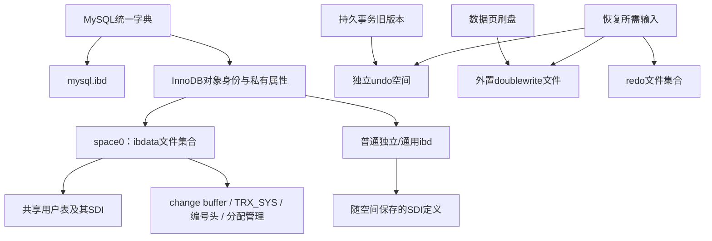

# 90. MySQL 8.0 系统表空间：元数据迁移与保留入口

## 学习目标与版本边界

本章以 **8.0.45、16 KiB、未加密的新初始化实例** 为准，解释ibdata1与mysql.ibd、undo、doublewrite及redo文件的关系。先读[第89章](89-mysql57-system-tablespace.md)的文件映射/事务概念、[表空间分配](75-space-allocation-layout.md)与[SDI记录](41-sdi-records.md)。

读完应能回答：哪些5.7结构已迁移，哪些页号/头字段仍保留；SDI与统一字典各承担什么职责；为什么相同页7不能再按5.7找SYS_TABLES；为什么ibdata1中的双写MAGIC不证明新版本仍在这里进行活跃双写。

本章是知识文档。源码规则、[独立样本](../system-tablespace-validation/README.md)与项目实现范围分别标识；不新增mysql.ibd统一字典解析、space0读行、undo/MVCC或恢复能力。8.0是版本系列，不能把8.0.45的文件布局套给所有早期小版本。

## 文件职责已经分开

| 文件/空间 | 8.0.45的主要职责 | 与5.7的区别 |
|---|---|---|
| 系统空间，通常ibdata1，engine space0 | change buffer、共享用户数据、分配管理、保留的事务/编号/兼容入口 | 不再以旧SYS_*表作为正常运行的主字典 |
| mysql.ibd | MySQL统一数据字典及mysql系统表 | 取代.frm和旧分散字典；是另一张表空间 |
| 普通独立/通用.ibd | 用户表、索引、LOB；适用空间中还有SDI | SDI提供随空间保存的序列化定义 |
| undo_001 / undo_002等 | 持久undo及各空间的rollback segment目录 | 默认持久undo进入独立空间 |
| #ib_16384_ID.dblwr等 | 正常模式的外置双写页暂存 | 8.0.20起迁出系统空间 |
| #innodb_redo/#ib_redoN等 | redo恢复日志 | 8.0.30起的新redo布局 |
| ibtmp1 / 会话临时空间 | 临时对象及对应临时undo管理 | 不能与持久undo或系统字典混读 |

系统空间仍可由多个文件组成，逻辑页映射规则与第89章相同。用户数据是否在space0由创建/重建方式决定，不由是否存在ibdata1决定。[8.0系统空间说明](https://docs.oracle.com/cd/E17952_01/mysql-8.0-en/innodb-system-tablespace.html)



### 小版本迁移不能省略

| 边界 | 需要牢记的变化 |
|---|---|
| 8.0统一字典体系 | .frm与旧字典发现方式发生变化；准确实现以目标版本源码为准 |
| 8.0.14 | 可通过SQL创建/管理额外undo空间；本章只核对默认两个空间的样本 |
| 8.0.20 | 正常双写存储迁到独立文件 |
| 8.0.30 | redo改用#innodb_redo；双写增加DETECT_AND_RECOVER / DETECT_ONLY模式 |
| 8.0.45 | 本章源码与实际字节基线；升级实例仍可能保留旧格式痕迹 |

依据分别见[Undo说明](https://docs.oracle.com/cd/E17952_01/mysql-8.0-en/innodb-undo-tablespaces.html)、[Doublewrite说明](https://docs.oracle.com/cd/E17952_01/mysql-8.0-en/innodb-doublewrite-buffer.html)与[Redo说明](https://docs.oracle.com/cd/E17952_01/mysql-8.0-en/innodb-redo-log.html)。知识对比不承诺这些中间版本的读取兼容。

## 统一字典、SDI与两个ID命名空间

mysql.ibd保存统一字典及mysql系统表；DD表是受保护的内部表，通过INFORMATION_SCHEMA/SHOW暴露所需信息，不能假定普通用户可直接SELECT其中全部内容。[mysql系统schema说明](https://dev.mysql.com/doc/refman/8.0/en/system-schema.html)、[DD访问规则](https://docs.oracle.com/cd/E17952_01/mysql-8.0-en/data-dictionary-schema.html)

InnoDB通过统一字典对象的 `se_private_id` / `se_private_data` 等属性保存引擎表ID、索引身份与根信息。表/列/索引的SQL对象定义与引擎物理标识不是一个数字空间。

| 名称 | 8.0.45源码或样本值 | 含义 |
|---|---:|---|
| dd::Tablespace对象的字典空间ID | 1 | 统一字典对象ID |
| dd::Tablespace对象的innodb_system ID | 2 | 同上，与engine space0不同 |
| mysql.ibd的engine space ID | 4294967294 | InnoDB保留的字典表空间ID |
| ibdata1的engine space ID | 0 | 系统表空间 |
| 本例private_rows的engine space ID | 2 | 普通独立表空间；数值恰好与上面的DD对象ID相同，不代表同一对象 |

不要把DD对象ID填到现有Schema.space_id中。文件页头和FSP记录的是engine space ID；SDI也同时携带不同层次的对象信息，需要按字段定义解释。

本例private_rows的官方SDI中，表的se_private_id为1065，两个索引的私有属性原文为：

```text
PRIMARY: id=156;root=4;space_id=2;table_id=1065;trx_id=1304;
n_idx:   id=157;root=5;space_id=2;table_id=1065;trx_id=1304;
```

由PRIMARY的root=4定位独立文件页4，再核对页内+66的索引ID156及+34的space2；本次SQL索引视图独立给出了相同身份。索引名称来自元数据，不由页头字节产生。这里的trx_id是索引私有元数据属性，不能拿它判断用户行提交状态；同样，页5的持久编号值不保证等于最后分配值。完整原文在固定SDI提取中保留。

SDI是随表空间保存的序列化定义，不是运行时统一字典全部记录的替代品。它可以帮助离线读取普通表，但不会提供完整事务状态/undo历史。本例官方ibd2sdi实际提取到：

| 文件 | SDI观察 |
|---|---|
| private_rows.ibd | 该表的Table对象与Tablespace对象 |
| ibdata1 | 本例共享用户表shared_rows的Table对象 |
| mysql.ibd | 包含mysql内部表定义的Table/Tablespace对象集合 |

因此“8.0的ibdata1完全没有元数据”也不准确：主字典迁走，但本例系统空间还保存共享表的SDI。mysql.ibd里的SDI描述表结构，并不等同于读取那些字典表中的所有对象记录。完整提取保存在证据目录，不能把提取成功称为本项目已支持这些空间读行。

## ibdata1的页0–7仍存在

本例最前面的页号/类型与5.7样本相同：0=FSP_HDR、1=IBUF_BITMAP、2=INODE、3=change buffer头、4=change buffer INDEX根、5=TRX_SYS、6=首个系统回滚段头、7=DICT_HDR保留入口。但页7后的解释已不同。

页0从+38开始24字节：

```text
00000000 00000000 00000300 00000140 00004800 0000002b
space0   reserved size768  limit320 flags    frag_used43
```

本例文件12582912字节，共768页；FSP_FREE_LIMIT=320不表示后面全部是有效使用页。flags=0x4800包含SHARED位（0x0800）与SDI位（0x4000）；PAGE_SSIZE子字段为0，表示传统16 KiB编码。它不是“整空间某一种表的行格式”。同实例普通独立文件的表级布局应另外核对。

8.0.45的SDI定位区在16 KiB页0的+10505，计算来自：

```text
XDES数组起点150 + 256个描述×40 + 加密元数据预留115 = 10505
+0：SDI物理版本，4字节大端
+4：SDI根页，4字节大端
```

本例ibdata1原文 `00000001 00000008`，即物理版本1、根页8。页8类型17853（SDI），不是5.7样本中页8的SYS_TABLES INDEX（17855）。mysql.ibd与private_rows.ibd的SDI根在页3，两个文件的定位原文均为 `00000001 00000003`。页号相同跨不同space没有冲突；SDI头的“版本1”也不是服务器8.0补丁版本。

### 页7：保留编号头，旧根字段不再是活跃字典

`DICT_HDR=38` 的编号字段偏移仍与5.7相同：

| 页内偏移 | 长度 | 字段 | 样本值 |
|---:|---:|---|---:|
| 38 | 8 | 持久化ROW_ID分配状态 | 256 |
| 46 | 8 | 引擎TABLE_ID分配状态 | 1065 |
| 54 | 8 | INDEX_ID分配状态 | 157 |
| 62 | 4 | 常规space ID分配状态 | 2 |
| 70、74、78、82、86 | 各4 | 旧SYS_*根字段位置 | 本例全部0 |

页7从+38开始的原文：

```text
0000000000000100 0000000000000429 000000000000009d
00000002 00000000 00000000 00000000 00000000 00000000 00000000
```

0x429=1065，0x9d=157。max_space_id=2不能解释成“所有文件space ID最大为2”：mysql和undo使用保留高位ID范围。ROW_ID和事务编号也存在批量持久化及启动跳跃，不保证与某次查询的最后一个分配值相等。

源码 `dict_hdr_create` 仍创建space0页7和编号字段；`dict_boot` 只有在 `srv_is_upgrade_mode` 时才装载旧SYS_*结构。新初始化实例这些旧根位置为0，不能把0当作合法SYS_TABLES根，再去解码FSP页。升级后的文件还可能保留旧值，是否是当前权威字典必须结合启动/升级路径判断，不能只看非零值。

## 事务页保留，持久undo入口已迁移

页5仍在space0，其+38事务编号字段和+56起的旧rollback segment槽结构保留。本例编号原文 `0000000000000501`，即1281；槽0 `00000000 00000006` 仍引用space0页6。

**页6还在，不等于当前持久事务undo仍集中在那里。** 本例有两个默认undo文件，持久事务使用独立undo空间；旧TRX_SYS槽还用于兼容/恢复检查。相关初始化代码会检查旧槽与各undo空间目录，不能把5.7的单套槽解释直接套给全部8.0回滚指针。

### 默认undo空间的真实页3

| 文件 | engine space ID | FSP flags | 页3类型 |
|---|---:|---:|---|
| undo_001 | 4294967279（ffffffef） | 0 | 21，RSEG_ARRAY |
| undo_002 | 4294967278（ffffffee） | 0 | 21，RSEG_ARRAY |

这些是本次初始化的保留ID；undo空间的生命周期和截断可能改变实际物理身份，不应只靠文件名判断。16 KiB默认undo文件本例各16777216字节；这不是所有实例的固定长度。

RSEG_ARRAY载荷从页内38开始：

| 页内偏移 | 长度 | 字段 |
|---:|---:|---|
| 38 | 4 | 版本标记，RSEG基值0x52534547加1，即52534548 |
| 42 | 4 | directory size字段，本例0 |
| 46 | 10 | 该目录的FSEG引用 |
| 56+i×4 | 4 | 当前undo空间内rollback segment头页号 |

undo_001的+38..71原文：

```text
52534548 00000000 ffffffef000000020032 00000004 00000005 00000006 00000007
version  size     FSEG:space/page/off  rseg页4  页5      页6      页7
```

FSEG指向同空间的页2偏移50。首个rollback segment在页4，类型6；其内部历史链与undo槽的概念延续第89章。

**本例size字段0，但目录有128个非空回滚段页指针。** 核查8.0.45的 `trx_rseg_array_create`：该字段初始化为0，源码中未发现对该偏移的其他更新引用；实际目录按槽读取。不能把头注释中的“size”机械当作已维护的活跃段总数，更不能据0判定没有undo。固定样本脚本检查所有已初始化槽区并计数；完整事务恢复仍需要更多语义。

undo空间和临时空间不按普通用户表创建SDI，这一点在 `dict_sdi_create` 的分支中明确处理。不能尝试将undo页3的RSEG_ARRAY当作普通表SDI根或用户索引根。

## Change Buffer仍与系统空间关联

页3/4仍承担change-buffer入口/树根，目标space/page的位图和真实二级操作具有不同职责。8.0.45本次实例的change_buffering=all；不能套用其他版本的默认配置推断它为空。含降序成员的二级索引或含降序主键的表还有缓冲限制，应核对目标版本规则。[8.0 Change Buffer说明](https://docs.oracle.com/cd/E17952_01/mysql-8.0-en/innodb-change-buffer.html)

与5.7一样，CRC成功和停止写入不证明所有缓冲操作已合并。普通单文件读取、完整二级逻辑状态和带恢复的读取属于不同认证范围。FOR EXPORT对目标表的合并/刷盘流程继续是现有受控采集方案的依据。

## 新双写文件与旧头可以同时存在

8.0.20后正常双写页写入独立文件。8.0.45源码以页大小和文件ID组织文件名；本例目录实际包含：

```text
#ib_16384_0.dblwr
#ib_16384_1.dblwr
```

它们分别参与flush-list / LRU及相关单页刷新安排；个数和大小受buffer pool实例及双写配置影响，不将本例文件尺寸写成格式常量。外部双写文件不是普通独立表空间，不能直接套用.ibd的FSP/XDES解析流程。

DETECT_AND_RECOVER/ON保存完整页用于检测和恢复；DETECT_ONLY只保存检测元数据，并非可取回完整页的副本文件，相关文件使用.bdblwr扩展。看到“双写已开启”还须区分具体模式。[双写配置说明](https://docs.oracle.com/cd/E17952_01/mysql-8.0-en/innodb-doublewrite-buffer.html)

### 为什么页5还有5.7式MAGIC与BLOCK1/BLOCK2

本例页5尾部旧入口仍有：

```text
1fffbd5f 00000040 00000080
MAGIC    起点64   起点128
```

这与5.7相同，不能据此推翻外置双写规则。8.0.45的 `srv0start.cc` 在新初始化时明确调用 `dblwr::v1::create`，以保持系统空间预期页分配顺序；已有实例启动时装载这些保留边界。`dict0boot.h/trx0sys.h` 中的旧定义有兼容用途，不是判断所有结构仍活跃的依据。

本次64/128页的持久类型观察为13（UNKNOWN）。源码的legacy创建路径先写LEGACY_DBLWR类型，而刷盘类型校正路径可将未列入保留分支的类型改成UNKNOWN；本次未记录逐页类型校正日志；这一路径解释属于源码推断，类型13是落盘字节的直接观察。这些页的类型值不能单独证明当前双写恢复模式。当前活跃模式应结合版本、配置、外部文件和恢复代码核对。

双写副本是循环暂存，不保证包含任意损坏页；若模式为DETECT_ONLY，更不能期待完整数据页。8.0与5.7恢复时都须匹配目标space/page、校验和及LSN，不能按文件位置把复制项当成另一份用户行。

## Redo和临时空间不是ibdata1的其他分区

8.0.30起，redo常见于 `#innodb_redo/#ib_redoN`，备用文件名带 `_tmp`；旧8.0默认ib_logfile0/1不能作为8.0.45所有实例的文件列表。本例实际目录清单保存在证据中。redo有专用日志块格式，不套用16 KiB FIL页解码。[Redo版本说明](https://docs.oracle.com/cd/E17952_01/mysql-8.0-en/innodb-redo-log.html)

ibtmp1是全局临时空间，管理临时表修改的回滚段；会话临时表数据有对应的会话空间，默认位于#innodb_temp目录。它们的创建/回收和重启生命周期不同于持久用户表与undo。[临时空间说明](https://docs.oracle.com/cd/E17952_01/mysql-8.0-en/innodb-temporary-tablespace.html)恢复和备份所需文件集合必须结合配置、版本与目标确定，不能只收集所有名为ibdata或后缀为.ibd的文件。

## 何时需要读取哪个文件

| 目标 | 5.7路线 | 8.0.45路线 |
|---|---|---|
| 普通独立表的受控快照读取 | ibd + 显式schema/indexes | 通常用该ibd中的受支持SDI |
| 离线查看全实例权威字典 | frm + space0旧字典 | mysql.ibd统一字典；实现需理解受保护DD表及引擎私有属性 |
| 读取space0内的共享用户数据 | 系统空间与正确表定义/身份 | 系统空间及对应定义/SDI；当前项目均未支持 |
| 检查/应用未合并二级变更 | 系统空间change buffer + 目标页 | 同样需要对应系统结构和目标页 |
| 定位持久undo | 系统TRX_SYS槽，可指向独立undo | 各undo空间RSEG_ARRAY为重要入口，并检查兼容结构 |
| 利用活跃双写副本 | 系统空间双写暂存区 | 依小版本/模式读取外部双写文件及必要兼容材料 |
| 事务可见性/崩溃恢复 | 配套系统/undo/redo等 | 配套系统/mysql字典/undo/redo/doublewrite等，按恢复范围确定 |

这是所需知识与输入的对比，不是当前CLI的可执行恢复方案。现有读取器成功只认证其请求范围；“有SDI”不保证事务一致性，“有mysql.ibd”也不保证能恢复所有历史行。当前实现边界仍见[第83章](83-release-support-matrix.md)。

## 源码定位、固定样本与复验

| 8.0.45源码 | 本章核对点 |
|---|---|
| [fsp0types.h](https://github.com/mysql/mysql-server/blob/mysql-8.0.45/storage/innobase/include/fsp0types.h#L158) | 固定入口和undo页3 |
| [dict0dict.h](https://github.com/mysql/mysql-server/blob/mysql-8.0.45/storage/innobase/include/dict0dict.h#L1130) | DD对象ID与引擎身份的区分 |
| [dict0dict.cc](https://github.com/mysql/mysql-server/blob/mysql-8.0.45/storage/innobase/dict/dict0dict.cc#L145) | mysql字典空间文件名 |
| [dict0boot.cc](https://github.com/mysql/mysql-server/blob/mysql-8.0.45/storage/innobase/dict/dict0boot.cc#L177) | 页7初始化、编号状态和upgrade-only旧SYS加载 |
| [dict0sdi.cc](https://github.com/mysql/mysql-server/blob/mysql-8.0.45/storage/innobase/dict/dict0sdi.cc#L125) | SDI创建与undo/临时空间分支 |
| [trx0sys.h](https://github.com/mysql/mysql-server/blob/mysql-8.0.45/storage/innobase/include/trx0sys.h#L262) | 保留TRX_SYS布局 |
| [trx0rseg.h](https://github.com/mysql/mysql-server/blob/mysql-8.0.45/storage/innobase/include/trx0rseg.h#L232) | RSEG_ARRAY字段与版本 |
| [trx0rseg.cc](https://github.com/mysql/mysql-server/blob/mysql-8.0.45/storage/innobase/trx/trx0rseg.cc#L1154) | 数组初始化和size字段观察 |
| [srv0start.cc](https://github.com/mysql/mysql-server/blob/mysql-8.0.45/storage/innobase/srv/srv0start.cc#L1920) | 保留旧双写布局的原因 |
| [buf0dblwr.cc](https://github.com/mysql/mysql-server/blob/mysql-8.0.45/storage/innobase/buf/buf0dblwr.cc#L1839) | legacy区域与外置文件命名/恢复 |
| [buf0flu.cc](https://github.com/mysql/mysql-server/blob/mysql-8.0.45/storage/innobase/buf/buf0flu.cc#L1085) | 刷盘页类型校正 |

样本来源、清洁关闭日志、完整文件解压SHA256、固定偏移JSON与SQL身份、官方工具结果均在[独立证据目录](../system-tablespace-validation/README.md)。官方ibd2sdi对上述三种空间提取成功；这是官方工具能力，不是Go自动入口能力。SYS_COLUMNS的旧记录格式观察、统一字典、SDI和undo数组核对也不能代替完整恢复实验。

当前[ReadSDI](../../sdi.go#L61)拒绝space0；[InspectTable](../../metadata.go)和[AnalyzeSpace](../../space.go)保留受支持独立输入约束。mysql.ibd包含多张内部表，也不能当作单一普通用户表传给ReadAuto。实现与教材事实分别维护，新增知识章节不改变支持范围。
