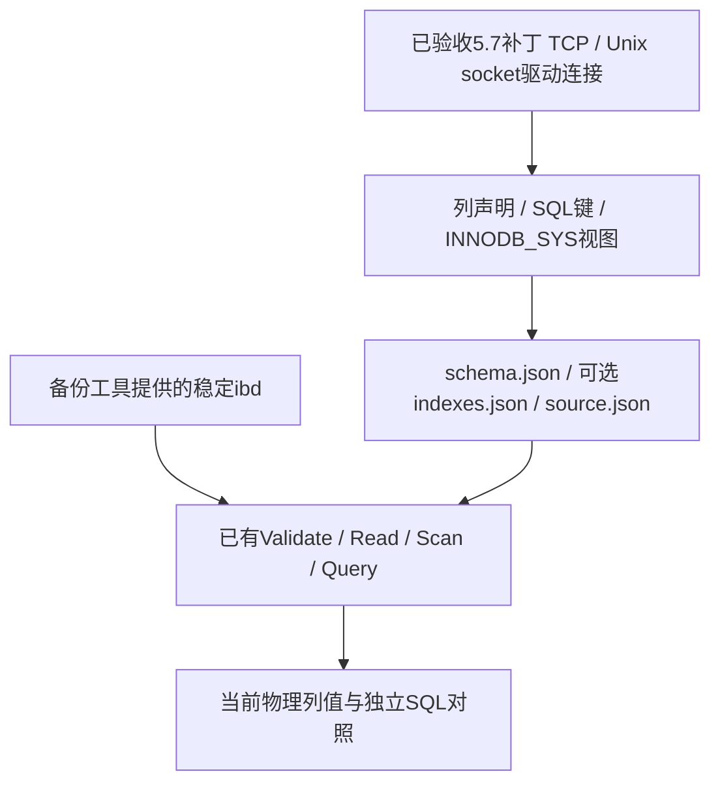
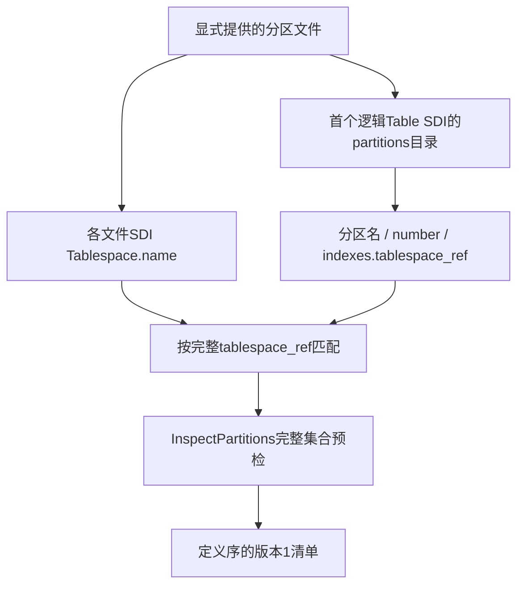

# 91. CLI输入准备：可信Schema与完整分区清单

CLI与HTML实现由[独立应用项目](https://github.com/kimihiro-dev/innodb-go-reader-cli/blob/main/README.md)维护；本章应用命令在该仓库根目录执行，库API示例在基础库根目录执行。原始验证结果保留其采集时的范围。

## 学习目标与前置概念

理解元数据采集、物理预检和行认证的区别，以及分区清单为何必须来自SDI或完整可信目录而不能只按文件名拼接。前置知识见[5.7显式元数据](87-mysql57-explicit-schema.md)、[二级物理字段](88-mysql57-secondary-indexes.md)和[分区集合布局](79-partition-collection-layout.md)。本章描述现有格式的CLI入口，操作步骤集中在[CLI指南](https://github.com/kimihiro-dev/innodb-go-reader-cli/blob/main/docs/CLI.md#schema采集可信定义)。

## Schema采集与物理读取分工



新增明确补丁的采集白名单和连接限制见[第92章](92-mysql57-patch-compatibility.md)。Go采集器沿用既有实例查询路线，使用database/sql与go-sql-driver/mysql，在一条专用连接上完成全部查询；统一utf8mb4、UTC和严格SQL模式。HEX包装的UTF-8 JSON保持既有来源格式，结果边界由SQL驱动提供；不再使用客户端进程或随机结束标记。JSON数字直接进入整数模型，uint64不经float64；原始source元数据保留SQL NULL。ENUM/SET通过MySQL自身解释其服务端COLUMN_TYPE字面量，不增加通用DDL解析器。

采集从SYS_INDEXES取得实际聚簇身份，结合SYS_FIELDS和STATISTICS构造物理字段；唯一非空聚簇键、隐藏DB_ROW_ID、前缀与二级聚簇后缀规则沿用第87/88章。SYS_TABLES.N_COLS核对可检测隐藏存储列缺失，不能推广为其他版本规则。source保存准确版本/环境/原始查询对象；schema只是物理布局声明，不自行证明版本或快照时点。

### 驱动连接与TLS

运行不依赖Docker、mysql客户端或Python。默认TCP主机127.0.0.1、端口3306；Unix socket与TCP/TLS参数互斥。密码只从指定环境变量读取，配置经mysql.NewConnector直接传递，不构造或记录DSN。source.connection记录不含密码的连接来源；驱动全局日志关闭，错误统一进入CLI JSON诊断。新增依赖仅限采集包，物理解析仍使用标准库。

TCP默认不加密；--tls要求证书链和主机名校验，最低TLS 1.2，私有CA通过--tls-ca追加到系统信任库。5.7.44测试服务器与Go默认套件没有交集，明确允许TLS 1.2 ECDHE/AES-GCM与RSA/AES-GCM；RSA密钥交换没有前向保密性。不支持跳过验证或失败后明文回退，详见[驱动连接说明](91-cli-input-preparation.md)与[Go TLS配置](https://github.com/golang/go/blob/go1.25.7/src/crypto/tls/common.go)。

### 根身份的真实字节

固定ordinary_dynamic的space133、聚簇index233/root3、二级index234..238/root4..8来自[既有独立SQL证据](../../testdata/mysql5744-secondary/ordinary_dynamic.source.json)。在16 KiB文件中，页0+34为4字节大端space ID，即`00 00 00 85`；页3起点49152，页3+66为8字节大端index ID，即`00 00 00 00 00 00 00 e9`。这里的+34/+66为页内偏移，49152为文件绝对偏移。

Schema命令仅从实例采集上述身份，不读取物理文件。使用备份工具提供的快照后，已有读取/metadata入口复用ValidateSchema及ValidateSecondarySchemas核对这些身份和根的局部结构。预检不扫描全部用户记录，不能仅据此宣布SQL结果认证；后续读取入口仍要求稳定快照和可信布局。

## Manifest名称发现与完整预检



逻辑分区名取自Table SDI的partitions.name，各物理文件以自身Tablespace.name与分区indexes.tablespace_ref对应。输入文件可以重命名，也可以乱序；首分区仍须提供，因为既有布局的逻辑Table SDI在那里。相同名字的文件、看似连续的p0/p1/p2文件名及目录扫描结果都不能证明集合完整。

真实ranges样本的映射来自[官方ibd2sdi原件](../../testdata/partitions/ranges-p0.sdi.json.gz)：

| 分区 | number | tablespace_ref后缀 | 引擎space ID | 聚簇index ID | 根页 |
|---|---|---|---|---|---|
| p0 | 0 | ranges#p#p0 | 821 | 1047 | 4 |
| p1 | 1 | ranges#p#p1 | 822 | 1049 | 4 |
| p2 | 2 | ranges#p#p2 | 823 | 1051 | 4 |

后缀只为阅读简写，代码比较完整名称，包括数据库前缀。根页4在三个文件中各指文件内65536字节处，不代表同一个物理页。发现名称后再次使用已有InspectPartitions严格检查SDI版本、完整性、归属、布局和所有请求根；重复/缺失/跨表等均失败。发现阶段的宽松对象投影只用于取得候选名称，不能代替后续严格预检。

### 清单格式与路径

```json
{"version":1,"files":[
  {"partition":"p0","path":"p0.ibd"},
  {"partition":"p1","path":"p1.ibd"},
  {"partition":"p2","path":"p2.ibd"}
]}
```

格式保持原有版本1契约。输出文件中的相对路径以清单目录为基准；stdout清单使用绝对路径，不随重定向位置改变含义。生成器按定义序保存，读取器仍自行预检并排序，因此手工清单的参数顺序不会改变扫描语义。文件输出复用已有完整成功后发布和输入别名保护，拒绝生成超过1 MiB的不可读清单。

## 生命周期、失败与验证边界

schema先在同一父目录的临时目录完成元数据采集和编码，成功后用Mkdir保留新的目标目录，再逐个发布完整文件。不存在整个目录的原子可见承诺；执行状态成功之前，不能消费多文件产物。目标已存在时拒绝，不替换已有目录；失败清理本次文件。结束时关闭专用连接和连接池；超时覆盖连接和全部查询，取消由驱动终止正在执行的网络操作。不保存密码或更改表定义/行数据。

manifest显式限制1..1024个输入、集合SDI 64 MiB，以及发现和预检累计源页读取预算。此初版流程现已扩展至明确8.0补丁；5.7可信目录与manifest v2另见[第94章](94-partition-version-compatibility.md)。不增加子分区、集合查询或跨分区全局顺序。schema元数据采集需调用者控制DDL并匹配备份工具提供的稳定文件；不提供锁表、快照复制或SQL下载.ibd能力，两者均不新增恢复/MVCC能力。

代码见[Go采集](https://github.com/kimihiro-dev/innodb-go-reader-cli/blob/main/internal/mysql57/collect.go)、[客户端会话](https://github.com/kimihiro-dev/innodb-go-reader-cli/blob/main/internal/mysql57/client.go)、[CLI准备入口](https://github.com/kimihiro-dev/innodb-go-reader-cli/blob/main/internal/cli/prepare.go)、[固定SQL对照](https://github.com/kimihiro-dev/innodb-go-reader-cli/blob/main/internal/mysql57/collect_test.go)、[协议/取消测试](https://github.com/kimihiro-dev/innodb-go-reader-cli/blob/main/internal/mysql57/client_test.go)与[清单端到端测试](https://github.com/kimihiro-dev/innodb-go-reader-cli/blob/main/internal/cli/prepare_test.go)。既有格式的独立来源继续使用固定SQL、官方SDI和原始文件；早期A来源缺少内部列计数时，单元测试明确使用合成补充，不冒充独立SQL。初版Docker入口验收保留在[输入准备报告](../input-preparation-validation/report.json)，当前驱动验收见[驱动验证报告](../schema-driver-validation/report.json)。
