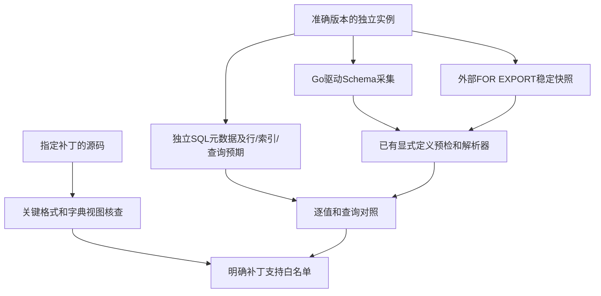

# 92. MySQL 5.7：明确补丁兼容与连接差异

## 学习目标与前置概念

区分补丁版本、实际物理布局和连接库能力，理解为何普通页/行解码可以复用，而采集入口仍采用明确版本白名单。前置知识见[5.7显式Schema](87-mysql57-explicit-schema.md)、[二级布局](88-mysql57-secondary-indexes.md)和[CLI输入准备](91-cli-input-preparation.md)。首次5.7.44验收材料保持原样，本章说明2026-10-14新增补丁的核查与边界。

## 已验收版本与范围

当前采集白名单为5.7.9、5.7.10、5.7.11、5.7.12、5.7.28、5.7.43、5.7.44。每个补丁以准确VERSION()和来源文件记录，不将5.7.13..27、29..42等中间未测试版本自动纳入。构建的-log后缀沿用既有处理；文件本身不能可靠确定补丁版本，显式Schema必须可信并匹配稳定快照。

新增六个补丁分别采集既有A/B两套组合：DYNAMIC/COMPACT、数值/时间/文本二进制/ENUM/SET/JSON/空间类型代表值、NULL/空值、旧LOB与更新/删除、主键/唯一实际聚簇/隐藏ROW_ID、STORED及未索引VIRTUAL、二级前缀/覆盖/回表、四个_bin规则及三层树。实际验收数字统一见[5.7补丁报告](../mysql57-patch-validation/report.json)，逐案例原件见[夹具入口](../../testdata/mysql57-patches/README.md)。精度、宽度和组合限样本证据，不推出其他5.7补丁或全部输入组合兼容。

## 源码差异与实现选择

用户提供的七份源码按VERSION文件核对，参考目录只读。核查fil0fil.h、fsp0fsp.h、fsp0types.h、rem0rec.h、btr0types.h、btr0cur.cc、i_s.cc、json_binary.h及viosslfactories.c；各文件SHA256、选定定义的行号和相对5.7.44的完整差异保存在[源码报告](../mysql57-patch-validation/source-report.json)及同目录source-diffs。

| 部分 | 核查结果 | 当前实现影响 |
|---|---|---|
| 页头、紧凑记录头 | 当前读取的页号、链、类型、space/index身份及紧凑记录字段沿用相同布局 | 复用已有页/记录解码 |
| 旧LOB | BTR_BLOB_HDR_PART_LEN=0、NEXT_PAGE_NO=4、HDR_SIZE=8一致 | 继续读取FIL_PAGE_DATA处的旧BLOB头及页链 |
| 二进制JSON | json_binary.h的完整格式说明七份逐字节一致；类型码、大小对象宽度及opaque格式沿用 | 未增加补丁解码分支；真实值另与SQL核对 |
| 系统字典视图 | 所需ID、PAGE_NO、N_FIELDS、SYS_FIELDS.POS、N_COLS及表空间大小/类型字段都存在 | 查询按字段名，不依赖视图列位置 |
| 5.7.10视图变化 | SYS_TABLESPACES移除COMPRESSION列，当前查询没有使用该列 | 无需适配该删除；仍拒绝压缩布局 |
| 5.7.11/12加密 | 引入加密标志及加密信息V1/V2分界 | 保持非目标，未实现解密或keyring读取 |
| TLS | 早期yaSSL与后期OpenSSL构建的协议/密钥编码能力不同 | 明确连接限制，最低TLS 1.2保持 |

源码字段一致只能说明相关读取规则没有发现变化，不能替代真实文件验收。5.7.9默认DYNAMIC与COMPACT默认值的历史变化也不能代替表的实际ROW_FORMAT。解码按可信Schema分派，采集按实例实际属性声明。

### 固定字节定位

以各补丁的scalar_dynamic_initial为例，整数均为大端；下列offset为页内偏移：

| 字段 | 页内偏移 | 长度 | 5.7.9原件 | 解读 |
|---|---|---|---|---|
| FIL_PAGE_ARCH_LOG_NO_OR_SPACE_ID | 34 | 4 | `00 00 00 18` | space ID=24 |
| FSP_SPACE_FLAGS（页0） | 54 | 4 | `00 00 00 21` | 当前16 KiB、独立DYNAMIC布局的标志 |
| PAGE_INDEX_ID（根页3） | 66 | 8 | `00 00 00 00 00 00 00 29` | index ID=41 |

根页3起点为文件绝对偏移`3×16384=49152`；index ID字段因此在`49152+66=49218`。旧BLOB页的8字节头从页内38开始，长度和下一页号在38和42，实际载荷从46开始；Schema页外引用仍按原规则提供首个LOB页号和总长度。

这些ID是各自实例分配的身份，不是版本号。5.7.12该样本space ID=35、index ID=63；5.7.28为25/47，其余新增补丁为24/41。六份样本页0+54均为`00 00 00 21`；各样本SHA256和原始字段提取见[字节报告](../mysql57-patch-validation/bytes.json)，可从对应.ibd.gz无损复核。

## 连接能力按构建分别验收

| 本次官方镜像 | 原生Unix socket / TCP采集 | 实测最高TLS协议 | 当前--tls |
|---|---|---|---|
| 5.7.9 | 通过 | TLS 1.0 | 明确拒绝 |
| 5.7.10、5.7.11、5.7.12 | 通过 | TLS 1.1 | 明确拒绝 |
| 5.7.28、5.7.43 | 通过 | TLS 1.2 | CA与主机名验证通过 |
| 5.7.44 | 既有驱动验收通过 | TLS 1.2 | 既有验收通过 |

四个早期构建的Go诊断分别为server selected unsupported protocol version 301/302，不会静默降级。原生socket实测是在容器内运行同一个静态Linux Go二进制，连接服务器实际Unix socket，产品调用PATH为空；这与此前macOS字节代理实验分别记录。

这里记录的是这些镜像构建的能力，不推定同补丁的自编译OpenSSL构建相同。当前客户端最低TLS 1.2、证书链/主机名验证、AES-GCM套件及不回退明文的契约沿用[驱动连接说明](91-cli-input-preparation.md)。远程早期实例需提供符合这些要求的连接环境；不因兼容测试放宽安全参数。TLS诊断中的have_openssl变量在旧构建也返回YES，不能单凭其名称判定实际SSL库。

早期yaSSL不能读取测试工具默认生成的PKCS#8私钥，实验改用同一RSA密钥的传统PKCS#1编码后确认have_ssl=YES。该调整属于测试服务器配置，不是产品放宽证书验证或密钥协议。

## 独立证据与失败边界

5.7.9..12官方镜像使用Docker schema1封装，当前Docker拒绝直接加载。测试从官方注册表取得原始manifest及文件层，验证每层压缩SHA256和解压diff ID后转换为本地Docker archive；MySQL二进制内容不修改。来源摘要、转换脚本和加载后镜像ID保存在[证据目录](../mysql57-patch-validation/README.md)。这不是从用户源码编译的二进制，源码核查与运行镜像验收两种证据分别标识。

Schema采集仅输出元数据。独立Python夹具工具在FOR EXPORT锁内取得SQL预期和物理文件，生产命令没有复制文件、锁表或恢复能力。根预检、Read/Scan/StreamLOB、聚簇/二级查询按原契约运行；未索引VIRTUAL仍需显式仅物化入口，FULLTEXT、索引化VIRTUAL及删除全文索引后残留隐藏DOC_ID等保持拒绝。每个新增补丁另实测七类不支持布局的CLI失败清理，见[拒绝报告](../mysql57-patch-validation/rejections-report.json)。

代码入口：[版本校验](https://github.com/kimihiro-dev/innodb-go-reader-cli/blob/main/internal/mysql57/collect.go)、[独立采集工具](../../scripts/mysql57_schema.py)、[固定元数据转换测试](https://github.com/kimihiro-dev/innodb-go-reader-cli/blob/main/internal/mysql57/collect_test.go)、[新增物理/SQL测试](../../mysql57_patch_test.go)。产品改动只扩大明确版本白名单和命令范围描述，没有改变物理解码器；不扩大5.7分区、系统/通用表空间、其他页大小、压缩/加密、MVCC或恢复支持。
