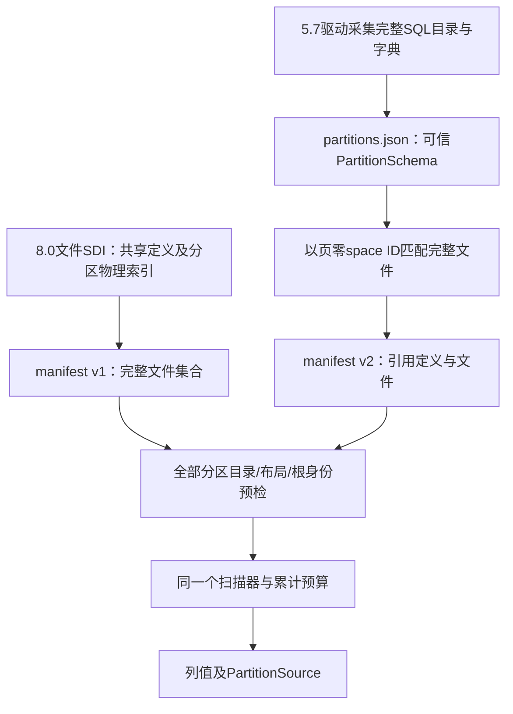

# 94. 分区集合：5.7可信目录与8.0版本差异

## 学习目标与前置概念

理解为什么一份可信单表Schema不能证明完整分区集合，以及怎样在5.7无SDI和8.0有SDI两种情况下复用物理解码。先读[集合布局](79-partition-collection-layout.md)、[集合验证](80-partition-validation-and-cli.md)、[5.7显式Schema](87-mysql57-explicit-schema.md)及[8.0补丁差异](93-mysql80-patch-compatibility.md)。本章描述2026-10-14当前源码，固定v0.1.0不含该扩展。

## 版本与方法

5.7明确版本为5.7.9/10/11/12/28/43/44，8.0明确版本为8.0.11/12/16/19/23/28/30/45。各版本实测普通RANGE、LIST、HASH和KEY，两种行格式、空分区、代表LOB/JSON/DECIMAL、更新删除、隐藏键、生成列、AUTO_INCREMENT、多层树与二级回表。8.0.12/16/19/23/28实测旧式INSTANT及局部重建，8.0.30/45实测现代ADD/DROP及局部重建，8.0.23/28/30/45实测不可见存储列。组合和精度限固定SQL证据，不推定全部类型或DDL的笛卡尔积。

| 操作 | 已验收范围 | 明确限制 |
|---|---|---|
| 普通完整集合 | 上述15个准确版本 | 16 KiB，独立、非压缩非加密，DYNAMIC/COMPACT |
| 重建首分区 | 5.7全部；8.0.11/16/19/23/28/30/45代表组合 | 8.0.12可保留已离开目录的共享列所有者，拒绝该快照 |
| EXCHANGE | 5.7全部；8.0.28/30/45代表组合 | 8.0.11/12/16/19/23可留下多个有效Table SDI，自动入口拒绝 |
| 元数据 | 5.7完整可信目录；8.0准确SDI组合 | 5.7目录/TableID来自可信来源，文件本身不能证明 |
| 集合扫描 | 定义序，各分区内部聚簇序 | 不承诺跨分区全局键序、路由或集合查询 |

子分区、LINEAR/COLUMNS、其他KEY算法枚举、系统/通用表空间、压缩/加密、跨版本升级混合文件和恢复继续不支持。早期子分区文件还可能没有可用Table SDI，此时拒绝缺失逻辑目录，不由文件名补造定义。

## 两条元数据路径



5.7继续依赖可信Schema，既不读取.frm/.par/ibdata1，也不执行分区表达式。`schema --partitions`仅采集元数据；调用方控制并发DDL并使定义匹配备份时点。每个分区具有独立table/space/index/root身份，不能给所有文件复用一个space/index ID。

当前在线采集将SQL目录与INNODB_SYS_TABLES中的直接名称绑定，支持已验收的ASCII名称和分区名大小写；需要MySQL filename字符集编码的名称明确拒绝。标准库和驱动没有该转换，未移植其字符映射表。外部可信PartitionSchema的UTF-8显示名和离线space ID匹配不依赖文件名。参考[5.7分隔符](https://github.com/mysql/mysql-server/blob/mysql-5.7.44/storage/innobase/handler/ha_innopart.cc#L69)及[filename编码](https://github.com/mysql/mysql-server/blob/mysql-5.7.44/strings/ctype-utf8.c#L7583)，拒绝比把编码名误配到其他文件更可靠。

## 可信目录与清单的两个版本号

`PartitionSchema.Version=1`是定义协议版本；`partitionManifest.version=2`是引用该定义的清单版本，两者不表示MySQL版本。

| PartitionSchema字段 | 含义与验证 |
|---|---|
| version / mysql_version | 定义协议1及准确5.7候选补丁 |
| database / table | 非空UTF-8逻辑身份；来源必须可信 |
| partition_type / expression | HASH=1、KEY=3、RANGE=7、LIST=8；表达式仅报告 |
| partitions[].name / number | 完整定义序，number从0连续；名称不重复 |
| table_id | 每分区独立非零ID；文件无法独立认证该ID |
| schema | 原有Schema，独立space/index/root；各分区逻辑列/键/行格式相同 |
| indexes | 可选原SecondarySchema；布局/定位与逻辑定义相同，物理身份独立 |

引用定义的真实格式如下，路径示例仅表示协议形状，具体名称从生成结果取得：

```json
{
  "version": 2,
  "schema": "definitions/partitions.json",
  "files": [
    {"partition": "P0", "path": "backup/a.ibd"},
    {"partition": "p1", "path": "backup/b.ibd"},
    {"partition": "empty_p", "path": "backup/c.ibd"}
  ]
}
```

定义和清单各限1 MiB，拒绝重复键、未知字段、显式NULL及尾随对象；清单版本1不接受schema引用，版本2必须引用。文件和定义路径相对清单所在目录解释；生成到stdout使用绝对路径。实际文件名可以与分区名无关，但空间ID必须唯一且与目录一致。不能把缺一个分区的清单当作成功的部分读取。

## 真实页字段定位

贯穿文件为`testdata/partition-patches/5.7.28/ranges_dynamic_current-0.ibd.gz`，对应P0。详细字节与其他分区对照见[物理示例](../partition-patch-validation/physical-examples.json)。

| 字段 | 文件/页内位置 | 长度与字节序 | 样本字节/值 |
|---|---|---|---|
| 页零FIL_SPACE_ID | 文件34 / 页内34 | 4，大端 | `00 00 00 92` = 146 |
| 聚簇root_page | 可信Schema指定3 | 页号，不是字节偏移 | 页3起点49152 |
| 根PAGE_INDEX_ID | 文件49218 / 页内66 | 8，大端 | `00 00 00 00 00 00 01 11` = 273 |
| table_id | SQL字典165 | 目录中的uint64 | 不伪装为.ibd内已认证字段 |

先按space ID将文件与P0匹配，再校验页零CRC/LSN/空间标志、Schema及根页的space/index身份、类型/局部布局和根无兄弟约束；可选二级也检查各根。这个预检不能证明所有后代页、行或当前LOB正确，完整扫描才检验它们。空分区也必须提供并完成预检。

## 共享列和INSTANT的版本差异

8.0.11/12的共享列table_id可能来自创建或重建时访问的分区。读取器仅在这两补丁从列属性取得一致所有者，并要求它是已验证完整目录的成员；其余版本保持首分区所有者检查。8.0.12重建首分区后若所有者不再是成员，拒绝而不任意改写ID。8.0.16以前分区序列化未包含subpartitions数组，表级subpartition_type仍必须为0；8.0.19及以后仍要求该字段。

旧式INSTANT的逻辑`instant_col`是各分区的最小原列数，分区属性保存自己的原列数。`8.0.28/instant_dynamic_partial_rebuild`真实样本中，逻辑值3，P0和empty_p仍为3，p1重建后属性为空且TableID已变化。共享列a/txt仍保留默认字节；p1已全存储这些字段，不能再用三列布局解码。适配只对逻辑新增且该分区已存储的列移除不适用默认属性；原始列上的非法默认仍拒绝。保留旧式分区的计数/默认补全，重建分区使用完整普通布局。后续再次ADD时分区原列数可大于逻辑最小值，必须保留这一差异，不能要求字符串完全一致。

AUTO_INCREMENT分区私有属性可同时有autoinc/version，version继续按uint64动态元数据解释，不当作行版本。REBUILD/EXCHANGE还可将JSON DD collation从63改为46；该两种已观察表示都按二进制JSON解码，容量和负载结构继续检查。已删除SDI单列保存，集合SDI总字节预算包含它们；当前目录只从有效对象发现。

准确源码文件指纹/定义行号见[源码核查](../partition-patch-validation/source-audit.json)。8.0.11/12/16/19/23 EXCHANGE样本存在多个有效Table对象，部分仍保留旧表空间名称；本轮保持唯一逻辑Table要求，未引入历史字典协调机制。

## API与命令行

5.7新增`InspectPartitionsWithSchema`、`ScanPartitionsWithSchema`和`ScanPartitionsMaterializedWithSchema`；8.0沿用既有入口。底层共享定义序、文件切换缓存清理、全局累计预算、VIRTUAL仅物化及PartitionSource。回调得到的元数据与私有扫描Schema隔离，不能修改后续根、列解释或来源。实现见[partition_schema.go](../../partition_schema.go)、[partition.go](../../partition.go)和[partition_metadata.go](../../partition_metadata.go)。

```sh
# 5.7：定义与物理快照须对应同一DDL状态
innodb-reader schema --host 127.0.0.1 --port 3306 --user schema_reader \
  --database demo --table orders --partitions --indexes --output definitions
innodb-reader manifest --partition-schema definitions/partitions.json \
  --output files.json backup/a.ibd backup/b.ibd backup/c.ibd

# 8.0：从完整SDI集合生成原清单，不用--partition-schema
innodb-reader manifest --output files.json backup/a.ibd backup/b.ibd backup/c.ibd

innodb-reader metadata --manifest files.json
innodb-reader check --manifest files.json
innodb-reader export --manifest files.json --output rows.jsonl
```

`--indexes`在5.7完整目录中保留各分区二级定义，集合仍只提供元数据、扫描、检查和导出；不是集合二级查询开关。数据输出保护同时包含清单、定义和全部文件。预检失败不输出任何行；扫描阶段超限/取消可有stdout前缀，但无成功end且Complete=false，文件结果只完整成功后发布。

独立SQL/官方工具、新失败测试、最终结果和复现说明集中于[分区验证报告](../partition-patch-validation/report.json)与[证据目录](../partition-patch-validation/README.md)。格式与SQL能力边界以[支持矩阵](83-release-support-matrix.md)为准。
