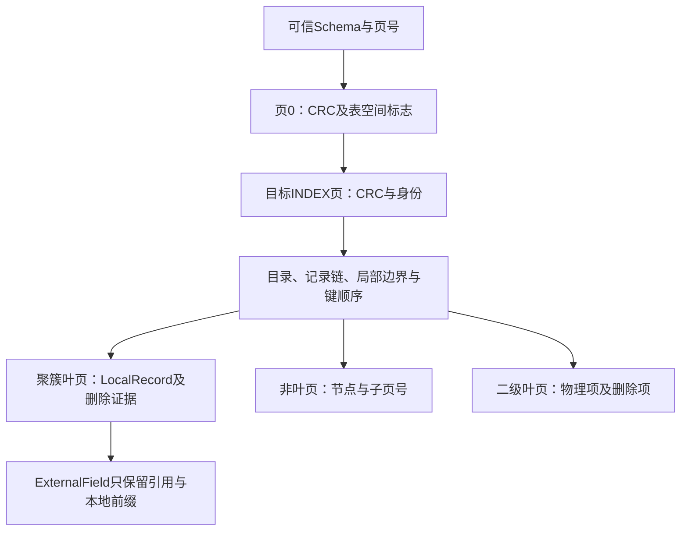

# 95. 独立页与本地记录读取

## 学习目标与前置概念

按页号读取原始字节、验证页封套或解码本地索引记录，并准确说明每种成功结果认证了什么。前置为[页布局](02-file-to-page.md)、[记录链](03-page-to-record.md)、[CRC/LSN](39-page-checksum.md)、[二级记录](71-secondary-record-layout.md)及[当前支持矩阵](83-release-support-matrix.md)。输入仍由调用方保证版本、稳定性和可信定义，不扩展格式或恢复能力。

## 四个公共入口

| 入口 | 输入与结果 | 读取范围 | 成功含义 |
|---|---|---|---|
| `ReadRawPage` | ReaderAt、文件大小、页号；返回独立`[]byte` | 指定页一次 | 取得完整16KiB，不校验内容 |
| `ReadPage` | 同上；返回`PhysicalPage{Header, Raw}` | 指定页一次 | 严格CRC32C、头尾LSN低32位及请求页号通过 |
| `ReadClusteredPage` | 同上及可信`Schema`；返回`ClusteredPage` | 页0和目标INDEX页 | 表空间标志、空间/索引身份与聚簇局部布局通过 |
| `ReadSecondaryPage` | 同上及可信`SecondarySchema`；返回`SecondaryPage` | 页0和目标INDEX页 | 表空间标志、空间/索引身份与二级局部布局通过 |

页号从0开始。文件必须按16KiB对齐，大小和页号越界明确失败；底层短读或I/O错误保留原因。`io.ReaderAt`允许完整读取同时返回`io.EOF`，该情况视为完整页；未读满的错误不吞掉。所有入口失败返回nil，不返回成功外观的部分结果。

局部索引入口先验证Schema属性，再读取页0和目标页；目标为页0时只读取一次，随后因不是INDEX类型而拒绝。它们不自动发现SDI、不预检全部索引根、不读取其他根、子页、兄弟页或LOB，不扫描全文件。可信Schema中的根页号保留其既有定义含义，但非目标根页不成为本次I/O依赖。

`ReadPage`的通用`PageHeader`只有FIL字段，类型未知时仍可返回页头和字节；它不会把未知载荷当INDEX解码。这个入口没有读取页0，因此不能独立判断表空间格式、加密/压缩或目标页当前分配。`ReadRawPage`还允许检查坏CRC或全零内容，不能据此宣称这些字节是有效数据页。

## 局部解码流程与结果模型



聚簇`ClusteredPage`包含`Page`、`Records`、`DeletedRecords`和`Nodes`；叶页与非叶页分别填充相应集合。`LocalRecord`是区别于完整`Record`的定义类型，沿用其来源字段，包括页内Start/Offset/End、事务字段、隐藏RowID、行版本、默认列和原始文本等。Values按`Schema.Columns`排列：

| 本地状态 | Values表示 | 来源与解释 |
|---|---|---|
| 普通内联值 | 既有整数、字符串、二进制、JSON/空间值等类型 | 已按既有类型规则解码 |
| SQL NULL | `nil` | 与空文本、空二进制保持区别 |
| 页外值 | `ExternalField`值 | 尚未取得完整列值，不填伪NULL |
| INSTANT补全 | 既有默认值或SQL NULL | DefaultColumns报告逻辑列索引，不伪造记录字节 |
| VIRTUAL | 不进入Values | 定义可存在，不求值；列索引仅指Schema.Columns |

本地CHAR沿用完整读取的去尾空格规则，并在CharStorage/TextBytes保留已有物理文本；外部CHAR仍是引用，不把本地前缀当作完整字符值。聚簇删除标记只输出`DeletedRecord`的键、原始本地字节和系统字段，不解码历史非键值。PAGE_FREE残留不输出为用户行。

二级`SecondaryPage`沿用`SecondaryRecord`和`SecondaryNode`，包含物理字段、前缀、聚簇定位字段及原始字节，不自动回表。有效非NULL唯一键在本页内检查，跨页唯一性和索引间对应关系未验证。非叶节点检查子页号非零、非自身且在文件范围内，不跟随指针，也不认证目标子页的类型或层级。

所有返回的字节和值由结果持有，不借用ReaderAt输入缓冲区；调用方可以保留或修改。局部入口是同步、最多两页的有界读取，不增加context或预算配置，也不保证能打断阻塞的ReaderAt。16MiB完整类型物化限制保持不变；本地引用尚未物化，不因其列值超过此上限而自动读取或拒绝整条本地记录。

## 页与字段的真实字节

贯穿样本为固定`testdata/mysql8045/lesson_rows.ibd`，对应Schema为同目录的`lesson_rows.json`。页4从文件偏移`4 × 16384 = 65536`开始，通用页头如下；下表偏移均相对页起点，整数为大端序。

| 页内区间 | 长度 | 实际字节 | 含义 |
|---|---|---|---|
| `[0,4)` | 4 | `bc f5 b4 04` | 严格CRC32C值，与页尾副本一致 |
| `[4,8)` | 4 | `00 00 00 04` | 页号4 |
| `[8,12)` | 4 | `ff ff ff ff` | 无前兄弟页 |
| `[12,16)` | 4 | `ff ff ff ff` | 无后兄弟页 |
| `[24,26)` | 2 | `45 bf` | INDEX类型17855 |
| `[34,38)` | 4 | `00 00 00 28` | space ID40 |
| `[66,74)` | 8 | `00 00 00 00 00 00 00 f9` | index ID249，需局部INDEX解码解释 |

逐步解码聚簇记录：

1. 通过页0的空间身份与标志，校验页4的封套和space/index身份，读取目录及记录链。
2. 记录origin按键序为`155 → 222 → 127 → 189`，物理位置无需递增；它们不是文件绝对偏移。
3. 第一条记录范围为页内`[148,182)`，origin为155。`[148,149)`是长度`06`，`[149,150)`是NULL位图`00`，`[150,155)`是固定头`00 00 18 00 43`。
4. `[155,159)`的`7f ff ff fd`解码为id=-3；越过6字节事务ID和7字节roll pointer后，`[172,176)`的`80 00 00 2a`得到score=42。
5. `[176,182)`的`49 6e 6e 6f 44 42`得到name=`InnoDB`。第一条Values为`[-3,42,"InnoDB"]`，完整四行与固定独立SQL预期一致。

这些偏移由既有[记录到列值](04-record-to-values.md)逐字节说明；普通局部Read不额外收集字段位置，需要时使用[第96章追踪入口](96-field-provenance.md)。`PageHeader`不提供上表INDEX专用字段，`ClusteredPage.Page`才有IndexID和Level等局部索引元数据。

## 调用示例与LOB后续读取

在仓库根目录运行最小[调用示例](../../examples/page/main.go)：

```sh
go run ./examples/page testdata/mysql8045/lesson_rows.ibd \
  testdata/mysql8045/lesson_rows.json 4
```

结果Page的Number/SpaceID/IndexID分别为4/40/249，四条记录的Values依次为`[-3,42,"InnoDB"]`、`[2,null,null]`、`[7,0,""]`、`[12,-5,"你好"]`。示例JSON用于检查本地模型，不是`rowio`无损行协议；以非Go程序消费其64位整数时仍须精确解析。

页外值可以显式交给已有`StreamLOB`，以下片段假定已有稳定reader、size、schema与一个localRecord：

```go
value := localRecord.Values[column]
switch v := value.(type) {
case innodb.ExternalField:
    // StreamLOB includes a COMPACT local prefix; do not prepend it again.
    report, err := innodb.StreamLOB(ctx, reader, size, v, options, consumeBlock)
    // Check both err and report.Complete before treating the bytes as complete.
    _ = report
    _ = err
case nil:
    // SQL NULL, not an unresolved external value.
default:
    // A decoded local value.
}
```

引用中的Length表示页外后缀长度，COMPACT本地Prefix单列保存。尚未读首个LOB页时，Format和Chunks没有经过链解析；不能仅凭Format为空就判断新式LOB。`StreamLOB`按已有引用规则和预算解释实际页类型，返回当前原始字节，不自动转换为SQL类型或恢复历史版本。

正式CLI的`page --number`仍先做完整空间分析，行为未改成本章接口。Go调用方要局部读取时应使用上述公共入口；完整当前行仍使用Read/Scan/Query及其适用变体。

## 验证、源码与边界

入口和模型见[page_read.go](../../page_read.go)，底层封套校验见[page.go](../../page.go)及[checksum.go](../../checksum.go)，记录与二级解码复用[record.go](../../record.go)、[tree.go](../../tree.go)、[secondary.go](../../secondary.go)。契约测试见[page_read_test.go](../../page_read_test.go)。

- 独立预期：固定SQL文件验证本地内联值及显式消费LOB后的值，人工字节验证页头、记录区间和外部引用位置；隐藏DB_ROW_ID不冒充SQL可查询字段。
- 回归对比：局部页与已有整树输出比较页、节点、记录及删除证据；该对比不能替代独立预期。
- I/O证据：测试ReaderAt记录每次读取，要求校验页仅目标页，局部索引仅页0/目标页；损坏SDI、未访问根/其他叶页或LOB时不扩大读取范围。
- 失败边界：坏CRC/LSN、错误页号/空间/索引、未知内部类型、非法Schema、短读、目录与记录链错误、越界/自指子页和本页唯一键冲突；CRC测试不重封，结构实验只对一次性副本重封并明确标为合成输入。

```sh
go test . -run '^TestRead(Local|Physical)' -count=1
go test . -run '^$' -fuzz '^FuzzReadLocalPage$' -fuzztime=10s -parallel=2
go test -race -timeout=25m ./...
python3 scripts/check_docs.py
```

局部成功不认证分配、父子范围、兄弟互链、未访问页、整树完整性、全部列值、LOB链或事务一致性。页0或可信定义是索引解码的必要前提；检查到未支持/损坏时明确失败。格式正确的残留页也可能通过局部解码，因此不得把局部记录集合当作已确认当前分配的完整表或抢救成功证明。
