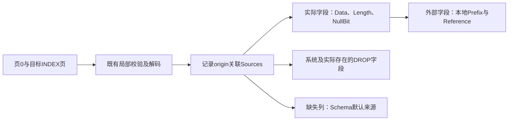

# 96. 字段级物理来源追踪

## 学习目标与前置概念

把当前逻辑列、系统字段和INSTANT补全与实际记录字节逐一对应，区分载荷、NULL位、长度项和未读取的页外来源。前置为[局部读取](95-local-page-reading.md)、[变长字段](11-variable-lengths.md)、[INSTANT布局](61-instant-row-layout.md)和[二级记录](71-secondary-record-layout.md)。格式、版本及快照前提继续以[支持矩阵](83-release-support-matrix.md)为准。

## 入口与收集过程

`TraceClusteredPage(reader, size, number, schema)`和`TraceSecondaryPage(reader, size, number, schema)`分别返回既有`ClusteredPage`与`SecondaryPage`，增加`Sources []RecordSource`。聚簇追踪还单独复制`VirtualColumns`定义，不求值。输入仍是调用方提供的稳定ReaderAt、文件大小、页号及可信Schema；不自动发现SDI。



解码器读取长度、NULL位及载荷时直接记录位置，不通过SQL显示值重新编码推测位置。普通Read/Scan/Query及局部Read不收集来源；新增集合为空时不进入JSON，既有读取模型保持原来的含义。Trace只读取页0和指定INDEX页，不跟随兄弟、子页或LOB。只追踪指定页上记录链中的记录，包含delete-mark；PAGE_FREE残留不变成用户行或字段来源。

## 模型与坐标

每个`RecordSource`以`Offset`关联相同页上的行、删除证据或节点；`Node`和`DeleteMarked`说明记录类别。`RowVersion`与旧式INSTANT的`FieldCount`仅在额外头字节实际存在时报告。固定五字节头及记录总范围继续使用已有记录模型。

| FieldSource字段 | 含义 |
|---|---|
| `Column` | 当前表列索引；聚簇对应Schema.Columns，二级对应SecondaryField.Column；系统/DROP为-1 |
| `Position` | 该记录中包含系统字段的实际字段序号，从0开始；默认补全为-1 |
| `Name`、`Kind` | 可信定义中的名称；类别为stored、default、dropped或system |
| `Null` | SQL NULL或NULL默认值；与空文本/二进制保持区别 |
| `Data` | 完整本地载荷区间；NULL及默认补全没有；存储空值保留Start等于End的区间 |
| `Length` | 实际变长元数据的1或2字节区间；固定宽度、NULL及补全没有 |
| `NullBit` | 可空物理字段的页内字节Offset及单bit Mask，无论该位为0或1 |
| `Prefix`、`Reference` | 外部Data的本地前缀和末尾20字节引用子区间，不额外计入载荷 |
| `Default` | 从可信Schema复制的InstantDefault编码字节及Null；不是当前记录中的物理数据 |

所有`ByteSpan{Start,End}`均为页内左闭右开区间。文件偏移为`int64(pageNumber)*PageSize + int64(Start)`，记录相对偏移为`Start - record.Offset`。Length在物理上逆向读取，返回的区间仍按地址从低到高排列；不能把读取顺序误当作正向编码顺序。NULL字段共享位图字节，各自只拥有一个位，不能逐字段重复累计整个字节。

Fields先按实际Position排列，默认补全随后按当前Column排列。Position描述当前这条记录，不能直接当作INSTANT元数据中跨版本保留的稳定physical_pos：缺失及DROP后不再存储的字段会改变实际序号。二级同一Column可有前缀和完整聚簇定位副本，必须以Position区分。

## 真实字节与逐步核对

样本为`testdata/mysql8045/lesson_rows.ibd`页4。文件页起点为65536，首行origin为155，值为`[-3,42,"InnoDB"]`。下表由固定文件字节及[第04章](04-record-to-values.md)人工解码核对，范围均为页内偏移。

| 名称/类别 | Position/Column | Data | 实际字节或解释 |
|---|---|---|---|
| id / stored | 0 / 0 | [155,159) | `7f ff ff fd`，有符号INT为-3 |
| DB_TRX_ID / system | 1 / -1 | [159,165) | `00 00 00 00 63 58`，6字节大端事务ID |
| DB_ROLL_PTR / system | 2 / -1 | [165,172) | `81 00 00 00 94 01 1d`，7字节物理指针 |
| score / stored | 3 / 1 | [172,176) | `80 00 00 2a`，有符号INT为42 |
| name / stored | 4 / 2 | [176,182) | `49 6e 6e 6f 44 42`，UTF-8文本InnoDB |

1. name的Length为`[148,149)`，字节`06`代表6字节载荷，记录相对偏移为-7。
2. name的NullBit为`{Offset:149, Mask:2}`；score使用同一字节的Mask=1。该字节为`00`，两列都非NULL。
3. name的文件字节区间为`[65712,65718)`，记录相对区间为`[21,27)`。字符数不能代替字节数；另一行“你好”的载荷是6字节。
4. origin=222的行中score/name为NULL，没有Data或Length，但各自有NullBit。origin=127的空name则有`Data=[148,148)`及`Length=[120,121)`，长度字节为`00`。
5. 源区间只说明编码与位置。事务ID和roll pointer不提供ReadView，无法由此推导事务提交或历史行。

## INSTANT、节点与删除边界

现代INSTANT解码先确定实际行版本及存在字段，再映射到当前列。新增列尚未物理写入时，返回Kind=default、Position=-1及独立复制的默认编码，无Data/Length/NullBit。NULL默认与存储NULL可通过Kind区分。改变当前SQL DEFAULT不改变ADD时的补全来源。

仍在旧记录中的DROP字段保留Kind=dropped、Column=-1及可信DroppedColumn.Name和物理区间，避免与同名重新ADD的列混淆；不解码其历史值。版本中已经不存在的DROP字段不生成伪区间。`testdata/instant/lesson_readd`同时覆盖旧物理a和当前重新ADD的a默认值`again`。旧式INSTANT按实际字段计数标出FieldCount，缺失的尾部列同样使用default来源。

隐藏DB_ROW_ID、DB_TRX_ID、DB_ROLL_PTR使用Kind=system和Column=-1；非叶页只标出实际键及4字节大端`child_page`，不补全叶页列。二级隐藏定位字段同样作为DB_ROW_ID系统字段。聚簇非叶记录预留的NULL位图是共享布局开销，不冒充不可空键的NULL位。

delete-mark来源解释仍存在的本地字段布局，非键值继续不作为当前SQL值输出；不补全删除记录中缺失的列。追踪遇到损坏、不支持、I/O失败时返回nil，不返回部分Sources；对删除/DROP字段也要求外部标记载荷足够容纳20字节引用，避免给出越界来源。局部成功不认证分配、整树、跨索引一致性或MVCC。

## 最小示例与页外来源

在仓库根目录运行[独立示例](../../examples/trace/main.go)：

```sh
go run ./examples/trace testdata/mysql8045/lesson_rows.ibd \
  testdata/mysql8045/lesson_rows.json 4
```

JSON同时包含原来的四行本地记录和四个Sources。首行Sources.Fields中name的Data/Length/NullBit应与上表一致；示例JSON不是rowio无损协议，跨语言使用64位整数仍需精确解析。若只需普通局部读取，继续使用[第95章示例](../../examples/page/main.go)。二级调用使用同参数形式的TraceSecondaryPage及可信SecondarySchema。

外部Data包含COMPACT本地前缀和20字节引用；DYNAMIC通常只有20字节引用。它们与`LocalRecord.External`按Column关联。仅追踪不会填充Chunks，也不能从尚未验证的Format推断实际LOB格式。

调用方显式把引用交给`StreamLOB`后，Prefix块来自本地前缀，其他块的`Chunk`给出实际页号、数据偏移与长度；`LOBBlock.Offset`是包含前缀的完整值内偏移。顺序拼接Data并检查error和Complete，不要再次预加前缀。已物化Record的页外来源仍使用`External.Chunks`；两种来源均不恢复历史链，规则见[第68章](68-streaming-lob-and-budgets.md)。

## 源码与验证

公共模型及入口见[field_source.go](../../field_source.go)，局部组装见[page_read.go](../../page_read.go)，位置在既有[记录解码器](../../record.go)、[INSTANT解码器](../../instant.go)、[节点解码器](../../tree.go)和[二级解码器](../../secondary.go)内收集。验证见[field_source_test.go](../../field_source_test.go)及[局部读取测试](../../page_read_test.go)。

- 独立预期：上述人工字节；局部读取矩阵继续以固定SQL核对追踪后的列值和显式消费LOB后的值。
- 结构核对：Data按Position连续覆盖载荷；Length、NULL位、行版本和计数位于元数据区域，无越界或重叠；多字节NULL位图、复合/隐藏键、二级重复定位副本和INSTANT映射分别验证。
- 回归及所有权：追踪与普通局部输出比较不代替独立证据；默认字节、VIRTUAL定义由结果独立持有。LOB流块与原始物理字节核对，并与完整读取Chunks作回归对比。
- 范围及失败：ReaderAt记录证明没有隐式LOB读取；真实CRC损坏不重封，结构模糊测试只重封一次性副本，不修改固定夹具。

```sh
go test . -run 'Test(FieldSource|ReadLocalClusteredSQL|ReadLocalSecondary)' -count=1
go test . -run '^$' -fuzz '^FuzzFieldSource$' -fuzztime=10s -parallel=2
go test -race -timeout=25m ./...
python3 scripts/check_docs.py
```
