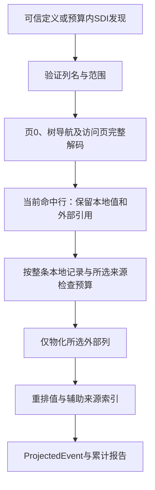

# 97. 聚簇列投影与按需LOB物化

## 学习目标与前置概念

只取得请求的列值，同时保留聚簇树导航、页内校验、来源及完成状态。前置为[聚簇范围查询](69-key-query-navigation.md)、[二级投影与回表](74-projection-and-lookup-validation.md)、[流式预算](68-streaming-lob-and-budgets.md)和[字段来源](96-field-provenance.md)。版本、格式与快照前提仍以[支持矩阵](83-release-support-matrix.md)为准。

## 入口与最小方案

| 入口 | 选择参数 | 回调与报告 | 认证范围 |
|---|---|---|---|
| `ScanProjected` | 可信Schema及`columns []string` | ProjectedEvent、ScanReport | 完整聚簇树及所选当前列值 |
| `QueryProjected` | 可信Schema及`ClusteredQuery{Range, Columns}` | ProjectedEvent、QueryReport | 访问路径和请求范围/Limit内的投影 |
| 对应`Auto`变体 | 从SDI发现Schema | 相同 | 元数据发现也消耗同一预算 |
| 对应`Materialized`、`MaterializedAuto`变体 | 显式存储列视图 | 单独报告VirtualColumns | 不求值VIRTUAL，不填伪NULL |

例如`ScanProjectedMaterializedAuto`用于自动发现后的存储列扫描，`QueryProjectedMaterialized`用于可信定义的存储列查询。存在VIRTUAL时默认入口拒绝，即使所请求列本身都是存储列；调用方须显式选择Materialized变体。

列名按可信定义严格匹配。`nil`选择全部存储列，非nil空列表、未知列、重复列和VIRTUAL列拒绝；输出顺序按请求列表。点查使用既有`PointKey`，范围沿用`KeyRange`的完整端点、前导列等值Prefix、ASC/DESC、Reverse和Limit。Prefix不是字符串前缀匹配。

实现复用二级投影的列名校验、聚簇树遍历、延迟外部引用、scanReader/LRU及既有类型解码；不引入依赖或另一套物理解码器。普通Read/Scan/Query继续要求完整列值。

## 解码与访问范围



访问页继续检查CRC/LSN、身份、目录、记录链、键顺序、父子范围及页内字段。所有本地外部引用都要通过既有解析，因此未选列的本地引用损坏仍会失败。未选页外链不读取、不作类型认证；选中值仍受16MiB类型物化上限约束。

扫描遍历完整树，保留每层首尾和兄弟链检查；不能因为复用了范围选择器就放过首兄弟不为空或末兄弟未访问的矛盾。查询只检查访问路径；不匹配的行不物化LOB，未访问叶页损坏不妨碍合法点查。两类结果均不认证事务可见性、未选页外值或跨索引一致性。

## 独立结果类型与列坐标

`ProjectedRecord`是区别于完整Record的定义类型，保留记录来源和系统字段，其Values只有所选列。SQL NULL仍为`nil`；未请求列根本没有槽位，不能通过填nil表示。`ProjectedEvent`只包含Page、Node、Record、DeletedRecord之一；节点与删除证据保留原来的完整键/本地字节含义，不按投影列裁剪，也不作为当前SQL行。

| 信息 | 投影后的含义 |
|---|---|
| `Values[i]`、报告`Columns[i]` | 相同请求顺序；未选用户键不自动加入Values |
| `TextBytes`、`CharStorage` | 键为投影列索引；保留原文本编码及CHAR物理填充 |
| `EnumIndexes`、`SetMasks` | 键为投影列索引；保留原字典序号/位掩码 |
| `DefaultColumns` | 所选INSTANT默认补全列在投影中的索引 |
| `External.Column` | 投影列索引；只包含所选并成功物化的LOB，保留引用/前缀/Chunks |
| `PageNumber`、`Start/Offset/End`、固定头、事务字段、`RowID`、`RowVersion` | 原始整条物理记录来源，范围不会因裁列而缩短 |

记录范围仍为页内坐标；文件偏移为`int64(PageNumber)*PageSize + int64(Offset)`。节点和删除证据中的键顺序保持聚簇键定义顺序。第96章FieldSource.Column仍指原Schema.Columns，不能直接当投影下标；需要按可信列名/定义建立映射。

回调可以保留或修改交付结果，不改变后续事件；读取期间仍须保持快照和输入Schema稳定。投影不是完整Record，不能把Values较少的记录直接交给要求完整行的消费者。

## 真实字节与独立预期

固定`testdata/mysql8045/lesson_rows.ibd`页4的第一行origin=155，本地范围`[148,182)`。请求`["name","score"]`后：

1. 仍以`[155,159)`的`7f ff ff fd`解码id=-3用于导航和排序，id不进入投影Values。
2. 越过6字节事务ID与7字节roll pointer，`[172,176)`的`80 00 00 2a`解码score=42。
3. name长度项`[148,149)`为`06`，NULL位图149为`00`，`[176,182)`的`49 6e 6e 6f 44 42`为InnoDB。偏移与长度的含义见[第96章](96-field-provenance.md)。
4. 输出Values为`["InnoDB",42]`，TextBytes使用索引0；记录Offset仍为155，End仍为182。四行依次为`["InnoDB",42]`、`[null,null]`、`["",0]`、`["你好",-5]`，来自固定SQL预期的列重排。

超过物化上限的固定样本沿用`testdata/secondary_query/huge.ibd.gz`。其聚簇页4、origin128的payload引用位于页内153，20字节为：

```text
0000003a | 00000006 | 00000001 | 0000000001000001
space=58 | first=6  | offset=1 | flags=0,length=16777217
```

引用是大端字段，当前新式LOB引用的offset=1不等于普通页内数据偏移；详见[第74章](74-projection-and-lookup-validation.md)。按id=1点查且只选择marker，返回17，仅请求`[0,4]`；不读取LOB_FIRST页6。选择payload则按原类型上限返回ErrUnsupported；按id=2选择同列取得字节`61 62`，即ab。选择全部列也不会绕过超限检查。

## 预算、错误与完成状态

元数据、导航和所选LOB共用一个context、缓存、累计页请求/遍历项/行预算，不按阶段重置。`MaxRowBytes`计整条本地记录字节，加所选外部后缀和所选INSTANT默认编码；COMPACT前缀已在本地字节中，不重复计量。未选默认或页外后缀不额外计入。`MaxRows`在读取该行LOB前检查；计量不是RSS硬上限。

ScanReport/QueryReport的Columns为投影定义，页/节点/删除/记录计数沿用既有含义，I/O包括SDI及缓存请求。只有nil error与Complete=true表示请求范围完成；扫描也只认证所选页外值。查询满足Limit时Complete=true、LimitReached=true，不证明还存在后续行。

停止、取消、预算、底层I/O、类型/布局错误与回调错误保留`errors.Is`分类，Complete=false；回调计数包含返回错误的那次调用。已输出前缀不可撤回。ReaderAt或回调阻塞时，context不保证立即打断。

## 调用示例

在仓库根目录运行[投影扫描示例](../../examples/projection/main.go)：

```sh
go run ./examples/projection testdata/mysql8045/lesson_rows.ibd \
  testdata/mysql8045/lesson_rows.json name score
```

示例逐行写row，最后写report；失败时report.Complete为false，stderr解释错误且退出非零。存在VIRTUAL时显式传`-materialized`。这是库调用演示，正式CLI参数保持原样；示例JSON不是rowio无损协议，跨语言读取64位整数仍须保留精度。gzip物理文件先由调用方解压。

可信定义的点查可直接调用：

```go
query := innodb.ClusteredQuery{
    Range: innodb.PointKey(innodb.Key{int32(-3)}),
    Columns: []string{"name", "score"},
}
report, err := innodb.QueryProjected(ctx, reader, size, schema, query, options,
    func(event innodb.ProjectedEvent) error {
        if event.Record != nil {
            // Values follow query.Columns; the returned report describes their types.
            return consume(event.Record)
        }
        return nil
    })
// Check err and report.Complete; callback output may already exist on failure.
_ = report
_ = err
```

## 源码与验证

模型、入口、列选择与重映射见[projection.go](../../projection.go)；[tree.go](../../tree.go)保留导航及完整扫描两端检查，[scan.go](../../scan.go)提供共享预算，[lob.go](../../lob.go)提供原有LOB物化。二级查询复用同一列名校验，既有二级语义不变。

[projection_test.go](../../projection_test.go)用固定SQL核对投影和92条点查/范围/前导等值/反序/Limit查询；人工字节及I/O跟踪核对上述样本。其他完整读取输出只作来源、类型和辅助索引重映射回归，不称独立预期。测试还覆盖两行格式、隐藏/复合键、INSTANT、CHAR/字典/精确数值、生成列、删除标记、默认字节预算、回调所有权、首尾链损坏和控制失败。损坏只改一次性副本；CRC实验不重封，进入结构检查的副本明确标为合成输入。

```sh
go test . -run '^TestProjected' -count=1
go test . -run '^$' -fuzz '^FuzzProjectedRanges$' -fuzztime=10s -parallel=2
go test -race -timeout=25m ./...
go vet ./...
python3 scripts/check_docs.py
```
