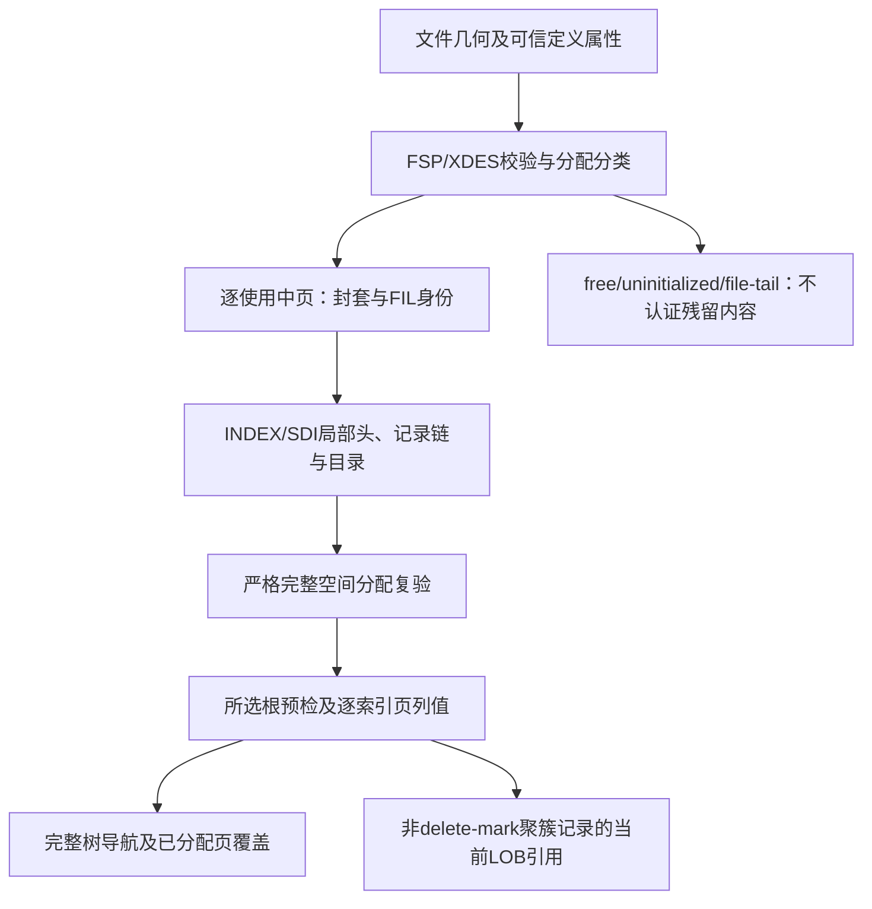

# 98. 结构化校验与分层诊断

## 学习目标与前置概念

在受控工作量内收集独立问题，定位已知来源，并区分输入通过、检查失败、依赖缺失和执行中断。前置为[页校验](39-page-checksum.md)、[空间分配](75-space-allocation-layout.md)、[字段来源](96-field-provenance.md)与[聚簇投影](97-clustered-projection.md)。格式、版本及快照限制仍以[支持矩阵](83-release-support-matrix.md)为准。

## 入口及完成含义

`Diagnose(ctx, reader, size, schema, DiagnosticOptions)`接受稳定ReaderAt、文件大小及可信Schema，返回DiagnosticReport和error。可在Secondary中显式提供二级定义；不自动发现SDI或推断所选索引列表完整。报告没有可导入行，不用于损坏数据抢救。

| 结果 | Complete | Passed | error |
|---|---|---|---|
| 所请求支持范围检查通过 | true | true | nil |
| 发现损坏或不支持，独立检查与阻断判定已结束 | true | false | nil；原因在Problems中 |
| I/O、取消、主动停止或预算中断 | false | false | 保留原始原因或ErrLimit |

预算耗尽还设置Truncated=true；其他中断不称为预算截断。调用方必须检查Complete、Passed和error，不能只判断error为nil。Passed只涵盖所请求检查，Unverified仍排除事务可见性/快照来源、未提供定义的索引、跨索引对应、VIRTUAL表达式及历史行/LOB值。

DiagnosticCheck按Layer/IndexID报告Scope、State、Checked和可用Reason。Checked是该阶段的访问/检查计数，不能当作通过数量或MVCC可见SQL行数。状态如下：

| State | 含义 |
|---|---|
| passed | 该请求范围的检查通过 |
| failed | 检测到可验证矛盾 |
| unsupported | 检查遇到不支持的定义/格式/物化边界 |
| blocked | 数据依赖未通过或不可用，不能认证本范围 |
| incomplete | 执行中断，未完成范围不可认证 |
| not_requested | 显式跳过的范围，例如SkipLOB |

同一范围若既有发现又发生中断，Problems与全局Complete共同表达结果；不能因已找到一个错误就认为其余部分已检查完。

## 依赖与独立收集



先复用FSP/XDES描述符解析，只有这些元数据有效后才知道哪些页需要封套校验。free、uninitialized、file-tail页的旧字节不因坏CRC被认定为当前数据损坏。描述符损坏时停止依赖的分类，不扫描字节猜测有效页。

对使用中页独立检查，坏页不阻止下一个独立页；每页布局不可靠后停止该页依赖检查。任一封套/局部布局未通过时，完整分配校验blocked，不能以部分分配结果继续认证树或列值。元数据有效且页检查通过后，复用严格AnalyzeSpace检查INODE、段、索引层和分配级兄弟链；它仍在任何错误时返回nil，不公开半个SpaceReport。

分配通过后，所选根还须处于used状态，不能仅凭free页中的合法残留通过预检。按所选索引逐页解码局部值，可以分别报告不同页的字段错误；一个页解码失败后不猜测其余字段。各索引单独报告；一个二级的值错误不阻止有效聚簇树检查。局部解码通过的索引再复用完整遍历，校验父子范围、层级、兄弟链和分配页双向覆盖：已分配索引页须可达，访问页也须属于该已分配索引。聚簇/二级相互对应仍是独立非目标。

LOB按已分配、非delete-mark聚簇记录的引用检查当前链及类型，独立引用失败后可继续其他引用。这个局部引用检查不能单独证明其所属记录在整树或事务中有效。删除记录只保留原来的键/布局证据，不还原历史非键值。

## 稳定问题代码与错误链

Problem实现error及Unwrap。Code和Category可用于程序分支，Message面向阅读；Expected/Actual记录期望和观察，不能把它们当作数据修复指令。Category为corrupt、unsupported或io，仍用errors.Is查询ErrCorrupt、ErrUnsupported和底层原因。

| 代码 | 校验边界 |
|---|---|
| input.geometry、schema.definition | 文件对齐/寻址及可信定义 |
| page.read、page.zero、page.checksum、page.lsn、page.number、page.identity | 页面读取、全零、CRC32C、LSN及FIL身份 |
| tablespace.format、index.identity、index.header | 表空间格式、索引身份及局部头/目录 |
| record.layout、field.layout、field.value | 记录布局/本地键顺序、字段元数据及编码值 |
| allocation.layout | FSP/XDES/INODE/段与分配级结构 |
| tree.navigation、tree.coverage | 键范围/层级/兄弟导航及已分配页可达性 |
| index.unique | 完整二级树中重复的非NULL声明唯一键 |
| lob.reference、lob.chain、lob.value | 本地外部引用、当前链及物化后类型 |

这些是边界类别，不为每条内部断言单独编号。未进一步细分的布局/导航问题保留对应子系统代码与原始原因；调用方无需解析错误字符串。既有严格入口的部分错误也可通过errors.As取得Problem，错误链和严格失败语义保留。

跨索引missing、extra、mismatch及duplicate_locator只由显式[第100章交叉校验](100-index-consistency.md)产生；Diagnose不因此增加聚簇/二级对应关系认证。

ProblemLocation只填写已知坐标：Page、IndexID、RecordPage、RecordOffset、当前逻辑Column/ColumnName和Bytes。Bytes是Page内左闭右开区间，文件偏移为`int64(*Page)*PageSize + int64(Bytes.Start)`；RecordOffset属于RecordPage，LOB出错页与其所属记录页可以不同。链错误尚不能精确定位内部字节时，位置可只标识本地引用；不能据此认定引用里的每个字节都是坏值。

缺少可靠位置时省略相应字段，不从错误字符串、可疑页头或残留内容猜位置。INSTANT错误列仍映射到当前Schema.Columns，DROP定义不冒充当前列；二级Column指表列，包含前缀时也不代表完整列值。Actual字节摘要最多64字节，不把整个坏值复制进报告。Cause不写入JSON，但Go调用方仍可errors.Is/As查询。

## 真实字节与合成损坏核对

固定`testdata/mysql8045/lesson_rows.ibd`页4从文件偏移65536开始，页头CRC为`bc f5 b4 04`，页尾CRC副本相同。首行origin=155，name位于`[176,182)`，真实字节为`49 6e 6e 6f 44 42`，值为InnoDB；来源见[第96章](96-field-provenance.md)。

1. 原始样本诊断为Complete=true、Passed=true，报告不包含行值。
2. 仅在一次性副本修改文件偏移65712的字节且不重封CRC，返回page.checksum、Page=4。期望为重新计算的CRC，实际为存储的头尾值；Bytes定位被比较的校验字段，不声称精确找到了载荷中被改动的字节。
3. 另一副本将name首字节改为FF，再重封CRC以进入字段检查。这是合成非法UTF-8，报告field.value，Page/RecordPage=4、RecordOffset=155、Column=2、ColumnName=name、Bytes=[176,182)。分配通过，列值失败，树检查blocked。
4. 描述符首项位于页0的150，state是相对偏移20的4字节大端值，即`[170,174)`。合成写0并重封CRC后，该已知边界报告allocation.layout；使用中页分类及后续树检查blocked，不把未知页内容当作通过。
5. 首项位图从174开始，每页两bit，最低位为free；页号n在其extent中使用第n%64组bit。有效描述符把某页标为free时，其残留CRC不会成为诊断损坏证据。

其他测试以真实多层树的两个不同叶页构造独立CRC损坏，要求两个page.checksum均保留；改变FSP fragment计数则定位`[58,62)`。这些损坏只存在于副本，原始快照和SQL/官方证据不改动。真实列值/字节与复用路径回归分别核对，不把两个Go输出互比当作独立认证。

## 预算与范围选择

DiagnosticOptions的MaxPages默认1000000，MaxIssues默认1000；ScanOptions默认沿用既有缓存、累计页请求/遍历/行及单行字节预算。描述符、全文件空间复验、局部解码、树复验和LOB共用一个scanReader/context；分配步进也计入同一遍历预算。缓存命中仍计请求，阶段切换不重置计数。

MaxPages限制文件页规模；保留问题已达到MaxIssues后再遇到新问题立即ErrLimit，不无限累计错误。问题按代码和完整已知位置去重，不合并不同页/记录/列的发现。MaxRows计局部解码阶段各所选索引的非delete-mark物理项，索引间不按SQL行去重；RecordsChecked同样不是MVCC行数。MaxRowBytes计本地记录、默认编码和需要校验的外部后缀；SkipLOB时不额外计算未访问后缀。

默认校验当前LOB类型，16MiB物化限制保持；超限报告unsupported，不伪装成确定损坏。SkipLOB只跳过链/类型检查，完整文件的使用中LOB页CRC和分配检查仍执行，因此不能把它当作不读LOB页的投影。需要按需访问时使用[第97章](97-clustered-projection.md)。

I/O失败可在预算内继续其他独立页/引用，最终返回保留所有已见I/O原因的错误，Complete=false。取消、ErrStopped或预算耗尽停止执行。完整ReaderAt页伴随io.EOF允许成功，短读或其他I/O原因不吞掉；context仍不能保证立即打断阻塞I/O。这些预算不承诺RSS硬上限。

## 示例与程序消费

在仓库根目录运行[最小示例](../../examples/diagnose/main.go)：

```sh
go run ./examples/diagnose testdata/mysql8045/lesson_rows.ibd \
  testdata/mysql8045/lesson_rows.json
```

可显式传`-indexes indexes.json`或`-skip-lob`。示例向stdout写JSON报告，发现问题或执行中断均退出非零，stderr解释原因；正式CLI参数不变。gzip文件先由调用方解压。跨语言消费64位整数仍需保留精度；报告不是rowio行协议。

严格读取中取得结构化原因：

```go
var problem *innodb.Problem
if errors.As(err, &problem) {
    inspect(problem.Code, problem.Location, problem.Expected, problem.Actual)
}
if errors.Is(err, innodb.ErrCorrupt) {
    // The original category remains reachable through Unwrap.
}
```

诊断报告则分别检查error与Complete/Passed，再按Problems和Checks生成展示；不能把Blocked检查改写成绿色通过，也不能把报告中的来源位置用于自动重写物理文件。

## 源码与验证

入口和依赖编排见[diagnostic.go](../../diagnostic.go)，问题模型及上下文合并见[problem.go](../../problem.go)；页/记录/INSTANT/二级解析器在既有失败边界附加来源。分配分类复用[space.go](../../space.go)的描述符路径，完整分配仍使用AnalyzeSpace，树与LOB仍复用既有解析，不降低读取/导出校验。

[diagnostic_test.go](../../diagnostic_test.go)验证正常代表快照、free残留、多坏页、根导航、描述符/分配依赖、字段/INSTANT/二级列映射、独立LOB引用、I/O/取消/短读及各预算；模糊测试核对来源范围和Complete/Passed/预算不变量。完整严格读取、投影、导出及其他包继续跑原有回归。

```sh
go test . -run 'Test(Diagnose|Problem|SpaceDamage|SpaceControl)' -count=1
go test . -run '^$' -fuzz '^FuzzDiagnose$' -fuzztime=10s -parallel=2
go test -race -timeout=25m ./...
go vet ./...
python3 scripts/check_docs.py
```
