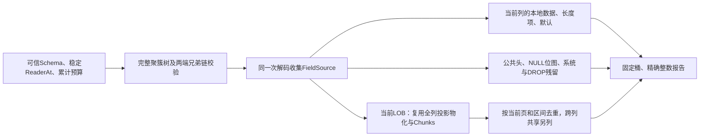

# 99. 行列存储分析与精确归属

## 学习目标与前置概念

解释当前行中每列的值编码、本地载荷、页外引用及公共记录开销，避免把声明容量、字符数和整页容量混为占用字节。前置为[字段来源](96-field-provenance.md)、[聚簇投影](97-clustered-projection.md)、[COMPACT](65-compact-row-layout.md)及[LOB块](68-streaming-lob-and-budgets.md)。版本和组合继续以[支持矩阵](83-release-support-matrix.md)为准。

## 入口与成功范围

`AnalyzeStorage(ctx, reader, size, schema, ScanOptions)`使用可信单表Schema，完整扫描聚簇树并物化全部当前存储值。返回`*StorageReport`和error；只有nil error及非nil、Complete=true的报告表示完成，任何错误返回nil报告。库不负责打开/关闭输入，不自动发现SDI，也不增加正式CLI参数。

`AnalyzeStorageMaterialized`显式允许VIRTUAL定义并在VirtualColumns单列报告；它们没有值、NULL计数或虚构载荷。普通入口遇到VIRTUAL拒绝。STORED生成列和INVISIBLE列沿用当前Schema的存储列顺序。



Rows是记录链中非delete-mark的当前物理行数，不称为MVCC可见行数。完整聚簇导航、已访问页封套、本地布局及当前值/LOB链得到检查；FSP分配、其他索引、事务快照来源、历史值、VIRTUAL求值和可归还磁盘空间留在Unverified中。若要认证分配或分析独立损坏，可另外使用[Diagnose](98-structured-diagnostics.md)，不能把两个报告的不同成功范围混在一起。

## 三种长度及列计数

每个ColumnStorage保留Column索引、Definition和MaxEncodedBytes。后者对CHAR/VARCHAR按声明字符容量乘字符集最大宽度，对二进制/LOB按声明字节上限，对数值、时间和ENUM/SET等取固定InnoDB编码宽度。它不是实际用量；例如VARCHAR(32) utf8mb4为128字节，LONGTEXT为4294967295字节，但本库类型物化上限仍为16 MiB。

| 字段 | 观测范围与字节含义 |
|---|---|
| Rows / Stored / Defaults | 当前物理行；Stored+Defaults=Rows，存储NULL仍计Stored |
| Nulls / DefaultNulls | 所有SQL NULL及其中来自INSTANT默认的NULL |
| EmptyValues | 非NULL文本/二进制的逻辑零长度；数值0、JSON null不算空值 |
| ExternalValues | 当前列实际包含外部引用的值数；DROP、删除记录不计入 |
| Encoded | 每个非NULL当前值的完整InnoDB编码长度；含COMPACT前缀或INSTANT默认，不含引用 |
| Logical | 仅文本/二进制的SQL值字节长度；使用声明字符集，CHAR去尾空格，BINARY保留补零；其他类型为nil |
| Local | 实际存储的非NULL字段载荷；含前缀及引用，不含长度项，默认补全不参与 |
| LengthBytes | 当前列实际存储的变长元数据字节数；不把共享NULL字节逐列分摊 |
| PrefixBytes / ReferenceBytes | Local.Sum内的子集；引用为每个外部字段20字节，不可再次相加 |
| ReferencedExternalBytes | 每个当前引用的页外后缀长度之和，可重复引用同一物理载荷 |
| DefaultEncodedBytes | Encoded.Sum内来自默认补全的部分；不会变成本地占用 |

Encoded不是SQL显示字符串长度：DECIMAL按压缩十进制编码、JSON按二进制JSON、空间值按原有SRID/WKB计量，ENUM/SET按物理序号/位掩码计量。它们的Logical为nil，避免把JSON文本大小或数字十进制显示宽度混入存储统计。文本Logical使用原始声明编码；latin1的欧元符号只占一个源字节，不能用Go UTF-8字符串的三字节长度替代。

CHAR的Encoded保留实际物理空格，Logical去除尾部ASCII空格；不会再补齐至声明容量。NULL无长度观测，实际存储空值Local存在零长度观测，默认空值只有Encoded/Logical观测。INSTANT旧行与新行按实际来源区分，DROP残留不归入同名重新ADD的列。

## 长度分布与整数协议

StorageLength包含Count、Sum、Min、Max及65个固定桶：桶0为零长度；桶k为`[2^(k-1), 2^k-1]`，k为1到64。例如1落桶1，2/3落桶2，4到7落桶3，256落桶9。没有观测时Count/Sum/Min/Max及所有桶均为0；无观测与有一个空值由Count区分。

桶是精确计数的分组，不是精确分位数或逐长度直方图。平均值可由Sum/Count以整数分子/分母保留；报告不先做浮点除法。所有64位计数、长度和桶的JSON值都是十进制字符串，包括大于2^53的数；Go内仍为uint64。计数相加溢出返回ErrLimit，不回绕或饱和截断。

## 记录字节的互斥分解

记录头和字段来源均为页内左闭右开坐标，文件偏移为页号乘16384再加页内偏移，记录相对偏移为页内偏移减origin。沿用真实解析位置，不重新编码显示值猜长度。

| 位置或字段 | 字节数、顺序及归属 |
|---|---|
| `[Start, Offset-5)` | 逆序变长长度项、共享NULL位图、可选INSTANT额外头 |
| `[Offset-5, Offset)` | 固定5字节记录头；记录链相对指针在末尾2字节大端编码 |
| `FieldSource.Data` | 字段实际载荷；系统、DROP及当前列分别计量 |
| `FieldSource.Length` | 实际1/2字节长度项；双字节值及外部标志由既有解码器解释 |
| `RowVersion / FieldCount` | 实际存在的行版本/旧式INSTANT字段计数头；计入InstantHeaderBytes |
| `DB_TRX_ID / DB_ROLL_PTR` | 6字节加7字节，计入SystemBytes；隐藏键再加6字节DB_ROW_ID |

NullBitmapBytes按整条记录的共享保留区计一次：`Offset-Start-5-全部Length字节-InstantHeader字节`。它包括实际保留位图字节中的未用bit，不按每列NullBit重复计字节。

成功报告满足以下恒等式，范围均为当前非delete-mark物理行：

```text
LocalRecord.Sum
  = Σ Columns.Local.Sum + Σ Columns.LengthBytes
  + HeaderBytes + NullBitmapBytes + InstantHeaderBytes + SystemBytes
  + DroppedPayloadBytes + DroppedLengthBytes
```

删除标记记录只累计DeletedRecords/DeletedLocalBytes，非叶节点只累计NodeRecords/NodeLocalBytes；两者不进入列分布和LocalRecord。页目录、FIL/INDEX页头、系统哨兵、页尾、垃圾和空闲也不摊入列，不能用上述当前行总和代替整文件占用。

## 真实字节逐步核对

固定`testdata/mysql8045/lesson_rows.ibd`页4的文件起点为65536。四行SQL预期分别为`[-3,42,"InnoDB"]`、`[2,null,null]`、`[7,0,""]`、`[12,-5,"你好"]`；物理键序与地址顺序不同。

| origin | 记录区间 | 文件区间 | 记录字节 | name载荷 |
|---|---|---|---|---|
| 155 | [148,182) | [65684,65718) | 34 | [176,182)，`49 6e 6e 6f 44 42` |
| 222 | [216,239) | [65752,65775) | 23 | SQL NULL，无载荷及长度项 |
| 127 | [120,148) | [65656,65684) | 28 | [148,148)，实际空值，长度项字节`00` |
| 189 | [182,216) | [65718,65752) | 34 | [210,216)，`e4 bd a0 e5 a5 bd` |

1. id为四个INT，载荷共16字节；score为三个非NULL INT，共12字节。score为0的行仍占4字节。
2. name有三个非NULL值，长度为6、0、6，合计12字节；NULL数为1，空值数为1。声明容量128字节不会参与此求和。
3. name三个长度项各1字节；首行长度项位于`[148,149)`，值`06`。score/name的NULL位共享同一个字节，各行计1字节，共4字节。
4. 每行固定头5字节及系统字段13字节，分别共20及52字节。
5. 记录总长为`34+23+28+34=119`，分解为`16+12+12+3+4+20+52=119`。没有LOB、INSTANT或DROP额外项。

这些长度由固定SQL预期和原始字节分别核对，来源详见[第04章](04-record-to-values.md)和[第96章](96-field-provenance.md)。不是将两条Go解析路径互比后称为独立证据。

## LOB引用、去重及页容量

全列物化沿用现有当前链校验及Chunks，不沿历史记录恢复值。COMPACT的768字节前缀仍在Local中，完整Encoded为前缀加引用后缀；DYNAMIC通常本地只有20字节引用。不能用`Local+后缀`作为完整值长度，因为Local还包含引用。

- ReferencedExternalBytes按当前引用累加后缀，可用于说明逻辑值总量。
- UniqueExternalBytes对当前块的`[Chunk.Offset, Offset+Length)`按页求区间并集，重复或重叠引用只计一次；本地前缀不在此集合。
- LOBReferencedPages取当前数据块页、当前活动项的IndexPage及每个引用FirstPage的并集；仅为读取/验证历史结构而访问的额外分配链页不自动归入当前页容量。
- 只有一个当前列引用的页计入该列ExclusiveLOBPages；跨列共享页计入全表SharedLOBPages。所有列Exclusive之和加Shared等于LOBReferencedPages，同列多行共用也只计一次。

各PageBytes为相应去重页数乘PageSize。一个LOB_FIRST页可以同时含当前载荷、索引项和历史残留，整页容量不等于当前载荷；Exclusive只描述当前引用列集合，不声称同页全部字节属于该列。未引用分配页、旧LOB值和空闲页不归到当前列。TreePageBytes同样只计所访问树页容量，不认证分配位图，不估算能归还操作系统多少空间。

测试在一次性副本上让二进制列引用文本列的同一当前链，验证共享页和区间去重；这属于合成归属测试，不作为正常写入器会生成共享引用或事务所有权的证据。另用合成重叠区间核对并集算法。真实COMPACT/旧BLOB、更新和INSTANT夹具保持不变。

## 预算、示例及验证

使用同一个scanReader/context/LRU，树、来源收集、全列物化及LOB共享累计页请求、遍历项、行和单行源字节预算；命中缓存仍算页请求。来源直接在已有页解码中收集，不逐页再读。MaxRowBytes在访问LOB前检查；类型值仍限16 MiB，MaxLOBBytes不放宽该限制。聚合只保留每列固定桶及有遍历预算约束的唯一LOB页/区间，不保留所有行，也不承诺RSS硬上限。

最小调用见[示例](../../examples/storage/main.go)，在仓库根目录执行：

```sh
go run ./examples/storage testdata/mysql8045/lesson_rows.ibd \
  testdata/mysql8045/lesson_rows.json
```

stdout仅在完整成功后输出JSON，Rows为`"4"`、LocalRecord.Sum为`"119"`；错误写stderr并非零退出。需要显式接受VIRTUAL定义时加`-materialized`，JSON的VirtualColumns保留定义。示例不提供原子文件发布，调用方输出文件仍须遵循现有发布约定。

实现见[storage.go](../../storage.go)，树解码的来源开关见[tree.go](../../tree.go)及[query.go](../../query.go)。[storage_test.go](../../storage_test.go)以固定SQL核对行数、NULL/空值和文本/二进制逻辑字节，覆盖两行格式、新/旧LOB、隐藏/复合键、当前更新、两类INSTANT、生成/不可见及代表5.7/8.0组合。SQL JSON视图不能区分JSON null与SQL NULL时，不用该视图认证JSON NULL计数。

验证还覆盖计量恒等式、桶边界/溢出/精确JSON、空表、删除标记、共享引用、I/O/取消/CRC/导航、累计预算及16 MiB限制。模糊测试只改副本，验证失败无部分报告和成功分解不变量；重封CRC的结构实验明确为合成输入。

```sh
go test -race . -run '^TestStorage' -count=1
go test . -run '^$' -fuzz '^FuzzStorage$' -fuzztime=10s -parallel=2
go test -race -timeout=25m ./...
go vet ./...
python3 scripts/check_docs.py
```
